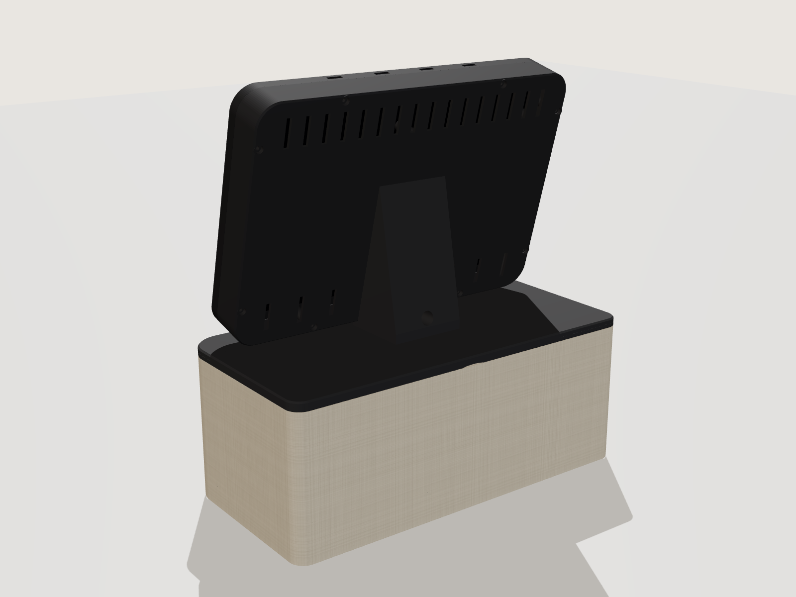
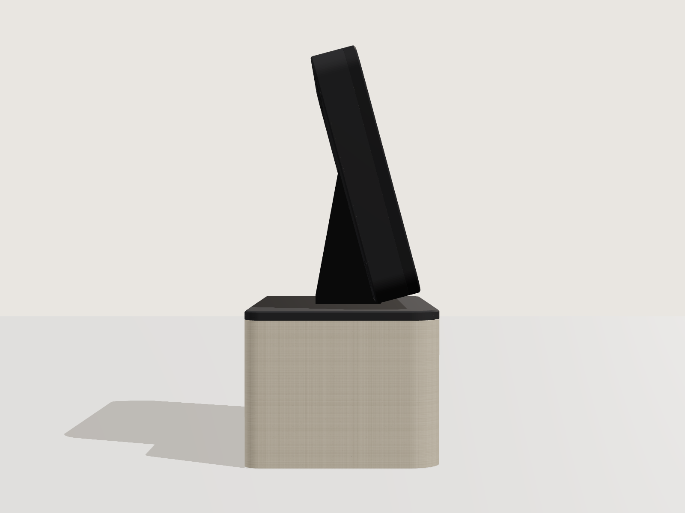

# SmartHub: Counter Display

An open source kitchen-counter smart display and sound system. A Samsung Galaxy Tab A9+ sits in a
tilted 3D-printed bezel on top of a linen-wrapped speaker base. A custom Android home app shows a
Home Assistant dashboard full screen with a dock of app tiles. A 24 GHz mmWave radar in the bezel
chin wakes the screen when someone walks up.


|  |  |
| --- | --- |
|  |  |

The renders show the first version of the bezel. The current bezel is 8 mm wider, with 13 mm side
borders instead of 9 mm, to make room for the USB-C adapter. Its tray is also 4 mm deeper, to fit
the KABD-430 amplifier.

The full parts list is in [BOM.md](BOM.md).

## How it works

- **Display.** The tablet runs **Counter Home**, a small Kotlin launcher that replaces Fully Kiosk.
  It is the Android device owner, so it can pin itself with lock task mode, turn the panel off and
  set brightness without root. No root means YouTube TV and Spotify keep full DRM.
- **Control.** Counter Home runs a token-protected HTTP API on port 2323. Home Assistant uses it to
  wake, dim, blank and navigate the display.
- **Presence.** An ESP32-C3 SuperMini reads an HLK-LD2410C radar and reports presence to Home
  Assistant over ESPHome. Automations wake the screen, fall back to a dim clock, then turn it off.
- **Sound.** The tablet's USB-C port goes through a right-angle adapter into a UGREEN 2-in-1 adapter.
  That adapter splits it into a 3.5 mm audio output and a USB-C charging input. A 3.5 mm cable runs
  to the AUX input of a Dayton Audio KABD-430 DSP amplifier in the bezel tray. The amp drives two Dayton ND65
  full-range drivers in sealed side chambers, plus a Dayton ND105 woofer loaded by a rear ND105
  passive radiator.
- **Power.** One 24 V adapter enters through the rear of the spine. It feeds the amp directly, a
  USB-C PD module that charges the tablet through the UGREEN adapter, and a small 5 V buck for the
  ESP32 and radar.
- **Volume cap.** The tablet's media volume sets the amp's input level. Counter Home holds media
  volume at or below a cap, 80 % by default, so the 15 W full-range drivers are not overdriven.

## Repository layout

| Path | What it is |
| --- | --- |
| [`android/`](android) | Counter Home launcher: Kotlin source, Gradle build, `setup.sh` provisioning script |
| `android/CounterHome-1.0.0.apk` | Prebuilt v1.0.0. It predates the volume cap, so build v1.1.0 from source |
| [`esphome/counter-presence.yaml`](esphome/counter-presence.yaml) | ESP32-C3 + LD2410C presence sensor firmware |
| [`homeassistant/packages/counter_display.yaml`](homeassistant/packages/counter_display.yaml) | REST commands, status sensors and the wake / ambient / off automations |
| [`homeassistant/auth_trusted_networks.yaml`](homeassistant/auth_trusted_networks.yaml) | Lets the dashboard load without a login screen |
| [`enclosure/enclosure.py`](enclosure/enclosure.py) | Parametric enclosure model (manifold3d). Generates every STL |
| `enclosure/stl/` | Print-ready STLs, already in print orientation |
| `enclosure/renders/` | Renders of the first version of the design |
| [`BOM.md`](BOM.md) | Bill of materials |

## Build order

### 1. Print the enclosure

The STLs in `enclosure/stl/` are ready to slice. They are the `print_*.stl` outputs of the script,
already oriented for printing.

| Part | Size (mm) | Notes |
| --- | --- | --- |
| `base_tub` | 300 x 150 x 116 | Speaker box with two sealed full-range chambers |
| `lid_spine` | 300 x 150 x 119 | Top plate and tilted stand in one piece. Glued to the tub |
| `grille_ring` | 299 x 149 x 112 | Linen wraps around it. Slides on from below, held by magnets |
| `bezel_front` | 284 x 200 x 10 | Prints face down. Holds the tablet and the radar |
| `bezel_tray` | 284 x 200 x 30 | Prints back wall down. Holds the amp, power modules and audio adapter |

You need a printer with at least a 300 mm bed axis; a 320 mm or larger bed is more comfortable.
The tablet alone is 257 mm wide, so the bezel cannot fit a 256 mm bed in one piece.
Use PETG or ASA for the bezel tray, because it sits behind a charging tablet and an amplifier.
Do not use carbon-fiber or metal-filled filament for the bezel front: the radar looks through its
2.4 mm lip.

**Before printing the tray, measure your KABD-430's height.** Dayton's user guide gives 20 mm and
retail listings give 23 mm, so the script assumes 23 mm. The tray depth follows `AMP_H`. A shorter
board gives a shallower tray, down to the original 26 mm.

**Before printing the tub, measure your drivers' screw bolt circles.** The tub has blind pilot
holes for the driver screws, but the bolt circles in the script are estimates. Correct `FR_BC`,
`WF_BC` and `PR_BC` and regenerate. The pilots stop 1 mm short of each chamber, so a pilot in the
wrong place leaves no air leak.

To change dimensions, edit the `PARAMETERS` block in `enclosure.py` and regenerate:

```
pip install -r enclosure/requirements.txt
python enclosure/enclosure.py enclosure/out
```

The script prints part volumes and the acoustic volumes: about 0.58 L per full-range chamber and
2.77 L gross for the woofer chamber. Copy the `print_*.stl` files over the ones in `enclosure/stl/`.

### 2. Assemble

1. Press the M3 heat-set inserts into the bezel front (8) and the spine (4).
2. Glue a 6 x 2 mm magnet into each of the 12 tub pockets and a 6 x 1 mm magnet into each ring
   pocket. Check polarity before the glue sets. The tub magnets sit 0.2 mm below the surface and the
   ring magnets sit flush.
3. Wire the drivers, pass the full-range leads through the chamber holes, and seal them with hot glue.
   Mount the drivers from the outside on gasket tape, using the pilot holes.
4. Add light stuffing, then glue the lid to the tub using the six dowels for alignment. The joint must be airtight.
5. Wrap the linen around the grille ring, then slide the ring onto the tub.
6. Bolt the tray to the spine and mount the amp on its standoffs. Stick the PD module, UGREEN adapter,
   5 V buck and ESP32-C3 into their cradles with VHB tape. Fit the radar in the chin pocket.
7. Connect the audio: right-angle adapter into the tablet, UGREEN adapter into that, PD module into the
   UGREEN charging port, and the 3.5 mm cable from the UGREEN audio jack to the KABD-430 AUX input (J13).
   Some Dayton documents call the analog input J5, but J5 is the programming port; check the silkscreen.
8. Put foam on the six tablet back-stop posts, drop in the tablet, and screw the front bezel on with M3 x 25 screws.

The right-angle adapter has to turn the plug back into the tray within 10 mm of the tablet edge.
If yours is bigger, raise `USB_CLEAR` and `FRAME_SIDE` together and regenerate the bezel.

If you hear hum or charging noise through the speakers, add a 3.5 mm ground loop isolator in the
audio cable. The tablet charger and the amp share one supply, which can create a ground loop.

### 3. Flash the presence sensor

```
cd esphome
esphome run counter-presence.yaml
```

The first flash needs USB; after that updates go over the air. Wiring is at the top of the YAML.
It needs `counter_presence_api_key`, `ota_password`, `wifi_ssid` and `wifi_password` in your
ESPHome `secrets.yaml`. Suggested radar tuning is in the YAML comments.

### 4. Provision the tablet

1. Build Counter Home v1.1.0, as described in [Building the app](#building-the-app). `setup.sh`
   installs that build when it exists, and otherwise falls back to the prebuilt v1.0.0 without the volume cap.
2. Factory reset the tablet. Connect Wi-Fi, skip every Google and Samsung sign-in, and turn on USB debugging.
   Device owner can only be set while the tablet has no accounts.
3. On your computer, with Android platform-tools installed:

   ```
   cd android
   ./setup.sh http://<HA_IP>:8123/dashboard-counter/0?kiosk
   ```

   It installs the APK, makes Counter Home the device owner, removes Samsung extras, and prints the
   tablet IP, the API token and the Home Assistant secrets. Reserve that IP on your router.
4. On the tablet, hold the dock clock for 3 seconds and enter PIN `2580`. Choose
   "Pause kiosk lock and open Android settings". Sign in to Google, install Spotify, YouTube TV,
   IPTV Smarters and the Home Assistant app, set Battery protection to Maximum, and make Home
   Assistant the default digital assistant. Then tap "Resume kiosk lock".
5. Change the settings PIN. The default PIN is public in this repository.
6. Set the volume cap by ear. Play music with bass at the cap, and lower "Max media volume" in the
   settings screen if the full-range drivers distort or bottom out.

Do the YouTube TV and Spotify sign-ins while the kiosk lock is paused. Google's login screens
belong to other packages, and lock task mode blocks them.

The KABD-430 still has Bluetooth, and its default DSP program mixes Bluetooth audio with the AUX
input. Anyone in range can pair a phone with it. A custom SigmaStudio program, loaded with a Dayton
ICP1 or KPX programmer, can drop the Bluetooth input.

### 5. Configure Home Assistant

1. Copy `homeassistant/packages/counter_display.yaml` into `config/packages/` and enable packages in
   `configuration.yaml`.
2. Add the three secrets `setup.sh` printed to `secrets.yaml`:
   `counter_display_token`, `counter_display_api` and `counter_display_status`.
3. Merge `homeassistant/auth_trusted_networks.yaml` into the `homeassistant:` block. Create a non-admin
   `counter` user and put its user ID and the tablet IP in the snippet.
4. Install the HACS "kiosk-mode" plugin so `?kiosk` hides the header and sidebar, then restart Home Assistant.

The automations expect the presence entity `binary_sensor.counter_presence_presence`, which the
ESPHome config creates.

| Time with nobody present | What happens |
| --- | --- |
| Someone arrives | Screen on. Brightness 25 from 22:00 to 06:00, auto otherwise |
| 2 minutes | Dim clock overlay, if the dashboard is in front |
| 10 minutes | Panel off, if the dashboard is in front |
| 30 minutes | Back to the dashboard and panel off, if another app was open |

A notification fires if the tablet battery stays above 42 °C for 5 minutes.

## Counter Home API

Every call needs `Authorization: Bearer <token>` or `?token=<token>`. Port 2323.

| Call | Does |
| --- | --- |
| `GET /status` | JSON: screenOn, ambient, launcherInFront, deviceOwner, kioskPaused, battery, charging, batteryTempC, volume, maxVolume, ip |
| `POST /screen/on`, `/screen/off`, `/screen/toggle` | Panel power |
| `POST /ambient/on`, `/ambient/off` | Dim clock overlay, tap to dismiss |
| `POST /home` | Back to the dashboard from any app |
| `POST /launch?app=Music` | Tile label or package name |
| `POST /assist` | Opens the default assistant (HA Assist) |
| `POST /navigate?url=...` | Load any URL in the dashboard view, such as a camera page when the doorbell rings |
| `POST /brightness?value=0-255` or `?value=auto` | Backlight |
| `POST /reload` | Reload the dashboard |
| `GET /config`, `POST /config` | Read or change settings as JSON: haUrl, tiles, dockSide, kioskLock, maxVolume, pin, port |

`volume` and `maxVolume` are percentages of the tablet's media volume range.

Quick test from any machine on the LAN:

```
curl -H "Authorization: Bearer <token>" http://<tablet_ip>:2323/status
```

Example tiles JSON, for the settings screen or `POST /config`:

```json
{"tiles": [
  {"label": "Music",   "package": "com.spotify.music", "color": "#1F8F4E"},
  {"label": "Live TV", "package": "com.google.android.apps.youtube.unplugged", "color": "#C43B33"},
  {"label": "IPTV",    "package": "com.nst.iptvsmarterstvbox", "color": "#3A62B8"},
  {"label": "Assist",  "action": "assist", "color": "#16A3C9"}
]}
```

Tile actions are `assist`, `reload` and `home`. The dock can sit on the right, left or bottom.

## Building the app

You need JDK 17+ and the Android SDK with platform 34. Point `android/local.properties` at the SDK
with `sdk.dir=/path/to/Android/sdk`, then:

```
cd android
./gradlew assembleRelease
adb install -r app/build/outputs/apk/release/app-release.apk
```

The app has no dependencies beyond the Android framework and the Kotlin stdlib.

**The signing keystore is not in this repository.** The repository is public, and anyone holding the
key could sign an update that replaces the device-owner app. Copy your `counterhome.jks` into
`android/keystore/` before building; that folder is git-ignored. Without the keystore the release
APK builds unsigned. Updates must be signed with the same key, or Android refuses to install them
over the device-owner app, and replacing a device owner takes a factory reset. Back the keystore up.

Store and key passwords default to the values the keystore was created with. Override them with the
Gradle properties `counterhome.storePassword`, `counterhome.keyAlias` and `counterhome.keyPassword`,
for example in `~/.gradle/gradle.properties`.

## Undo

Open the settings screen and choose "Release device owner". The tablet goes back to being a normal
Android tablet. A factory reset also clears it.

## Design review status

These items came out of reviewing the Cowork export.

| Item | Status |
| --- | --- |
| Magnet pockets too shallow for one 3 mm magnet each side | Fixed. Pockets now fit a 6 x 2 mm tub magnet and a 6 x 1 mm ring magnet |
| No room for a USB-C plug past the tablet edge | Fixed. Side borders are 13 mm, leaving 10 mm for a right-angle adapter |
| No mounts for the small boards in the tray | Fixed. Cradles for the PD module, UGREEN adapter, 5 V buck and ESP32-C3 |
| No pilot holes for the driver screws | Fixed with blind pilots. Measure your bolt circles first; the defaults are estimates |
| Full-range drivers can be overdriven | Fixed in the app with a media volume cap, 80 % by default. Tune it by ear |
| Four non-manifold edges in `base_tub` | Fixed. Two brace columns now overlap the side walls instead of touching them |
| Needs a 300 mm print bed | Not changed. The tablet is 257 mm wide, so a smaller bed would need a split bezel |
| Setup script printed the wrong Home Assistant secret names | Fixed |
| KABD-430 amp is taller than the original tray allowed | Fixed. Tray depth now follows the amp height, 30 mm for a 23 mm board |
