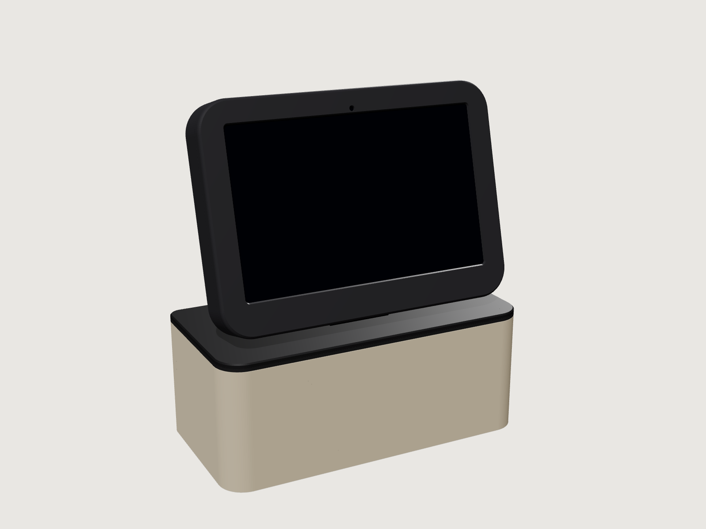
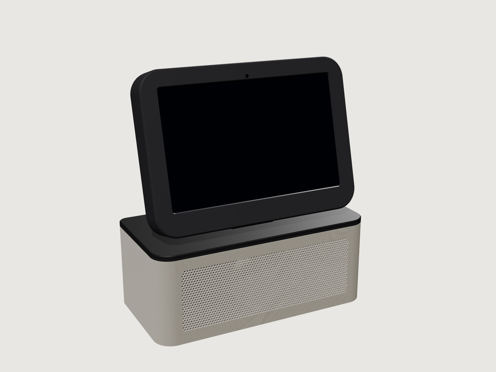
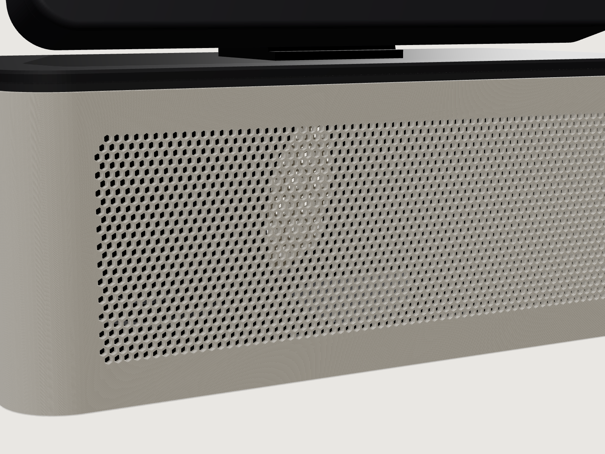
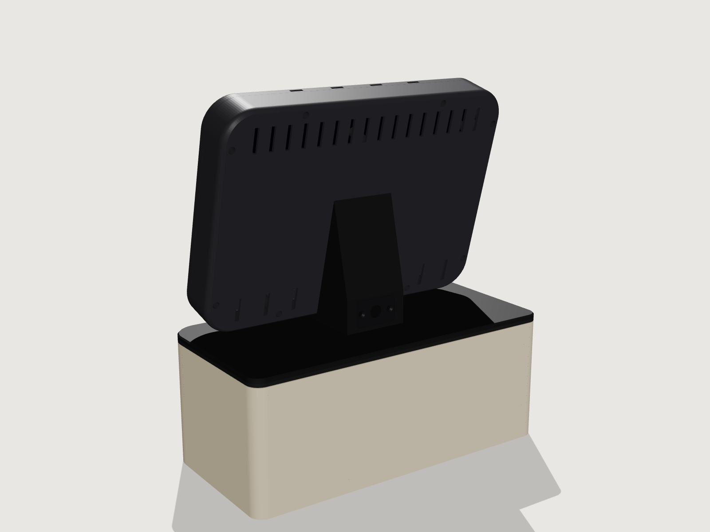
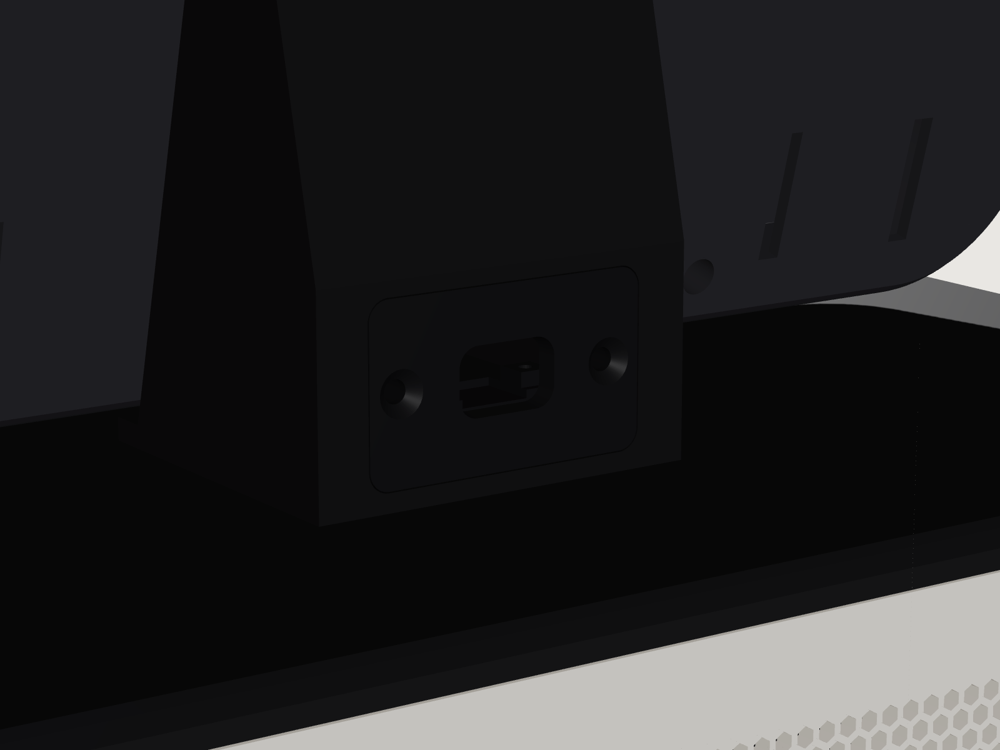
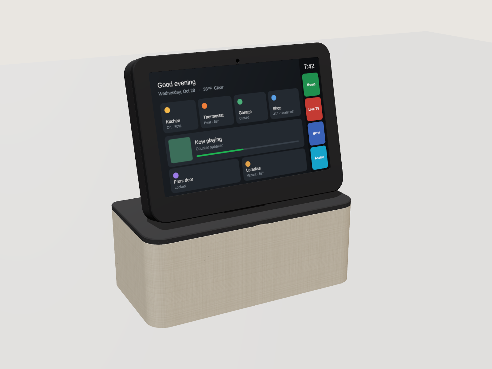
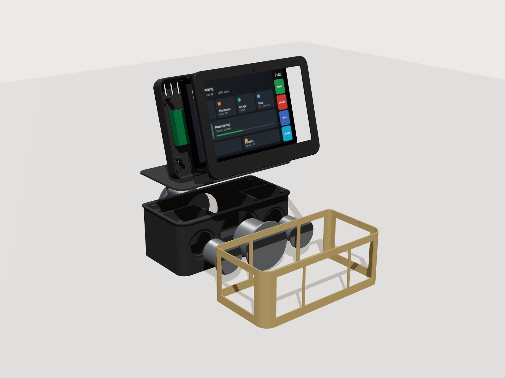
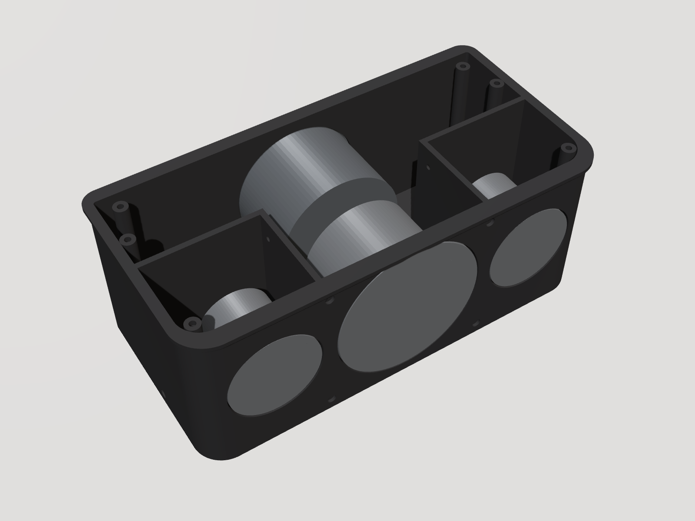

# SmartHub: Counter Display

An open source kitchen-counter smart display and sound system. A Samsung Galaxy Tab A9+ sits in a
tilted 3D-printed bezel on top of a speaker base, which can be wrapped in linen or fitted with a
printed honeycomb grille. A custom Android home app shows a
Home Assistant dashboard full screen with a dock of app tiles. A 24 GHz mmWave radar in the bezel
chin wakes the screen when someone walks up.



|  |  |
| --- | --- |
|  |  |

The `current_*` renders show the current STLs, with the linen base and with the fabric-free grille
shell. The bezel is frameless: the tablet's own black glass border shows, and a 6.8 mm printed rim
wraps its edge with a 1.2 mm lip that overlaps the glass by 1.5 mm. The chin below the screen holds
the radar.

The original Cowork renders show the first version and are kept for reference:

|  |  |  |
| --- | --- | --- |

The full parts list is in [BOM.md](BOM.md).

## How it works

- **Display.** The tablet runs **Counter Home**, a small Kotlin launcher that replaces Fully Kiosk.
  It is the Android device owner, so it can pin itself with lock task mode, turn the panel off and
  set brightness without root. No root means YouTube TV and Spotify keep full DRM.
- **Control.** Counter Home runs a token-protected HTTP API on port 2323. Home Assistant uses it to
  wake, dim, blank and navigate the display.
- **Presence.** An ESP32-C3 SuperMini reads an HLK-LD2410C radar and reports presence to Home
  Assistant over ESPHome. Automations wake the screen, fall back to a dim clock, then turn it off.
- **Sound.** The tablet's USB-C port goes through a flat FPC 90° adapter into a UGREEN 2-in-1 adapter.
  That adapter splits it into a 3.5 mm audio output and a USB-C charging input. A 3.5 mm cable runs
  to the AUX input of a Dayton Audio KABD-430 DSP amplifier in the bezel tray. The amp drives two Dayton ND65
  full-range drivers in sealed side chambers, plus a Dayton ND105 woofer loaded by a rear ND105
  passive radiator.
- **Power.** A small single-port USB-C charger at the wall feeds one thin USB-C cable into a flush
  port on the rear of the spine. Behind the port, an Adafruit HUSB238 PD trigger set to 20 V asks
  the charger for 20 V. That feeds the amp directly, a USB-C PD module that charges the tablet
  through the UGREEN adapter, and a small 5 V buck for the ESP32 and radar.
- **Volume cap.** The tablet's media volume sets the amp's input level. Counter Home holds media
  volume at or below a cap, 80 % by default, so the 15 W full-range drivers are not overdriven.
- **Camera.** The tablet's front camera, looking out through the bezel, can act as a security camera
  for Home Assistant. Counter Home serves snapshots and an MJPEG stream through its API, only while
  Home Assistant has turned the camera on, and only if it is allowed on the tablet.

## Repository layout

| Path | What it is |
| --- | --- |
| [`android/`](android) | Counter Home launcher: Kotlin source, Gradle build, `setup.sh` provisioning script |
| `android/CounterHome-1.0.0.apk` | Prebuilt v1.0.0. It predates the volume cap and camera, so build v1.2.0 from source |
| [`esphome/counter-presence.yaml`](esphome/counter-presence.yaml) | ESP32-C3 + LD2410C presence sensor firmware |
| [`homeassistant/packages/counter_display.yaml`](homeassistant/packages/counter_display.yaml) | REST commands, status sensors and the wake / ambient / off automations |
| [`homeassistant/auth_trusted_networks.yaml`](homeassistant/auth_trusted_networks.yaml) | Lets the dashboard load without a login screen |
| [`enclosure/enclosure.py`](enclosure/enclosure.py) | Parametric enclosure model (manifold3d). Generates every STL |
| `enclosure/stl/` | Print-ready STLs, already in print orientation |
| `enclosure/renders/` | `current_*` renders of the current design, plus the original Cowork renders |
| [`BOM.md`](BOM.md) | Bill of materials |

## Build order

### 1. Print the enclosure

The STLs in `enclosure/stl/` are ready to slice. They are the `print_*.stl` outputs of the script,
already oriented for printing.

| Part | Size (mm) | Notes |
| --- | --- | --- |
| `base_tub` | 300 x 150 x 116 | Speaker box with two sealed full-range chambers. Prints floor down, supports only in the outside driver recesses |
| `lid_spine` | 300 x 150 x 119 | Top plate and tilted stand in one piece. Glued to the tub |
| `grille_ring` | 299 x 149 x 111 | Linen version. Linen wraps around it. Slides on from below, held by magnets. Prints bottom edge down |
| `grille_shell` | 300 x 150 x 112 | Fabric-free version, instead of the ring and linen. Prints bottom edge down |
| `bezel_shell` | 272 x 197 x 36 | Prints back wall down, front rim on top, no supports. Rim, tablet pocket and tray in one piece |
| `bezel_chin` | 272 x 23 x 9 | Prints back face down, no supports. The chin bar: holds the radar and the lip along the bottom of the glass |
| `power_plate` | 44 x 26 x 33 | Prints face down with the sled standing up. Carries the USB-C PD trigger |

You need a printer with at least a 300 mm bed axis; a 320 mm or larger bed is more comfortable.
The tablet alone is 257 mm wide, so the bezel cannot fit a 256 mm bed in one piece.
Use PETG or ASA for the bezel shell, because it sits behind a charging tablet and an amplifier.
Do not use carbon-fiber or metal-filled filament for the chin: the radar looks through 1.6 mm of it.

**Frameless bezel.** The front rim and the tray are one part, so there is no seam on the front
above the chin. The tablet slides up into the shell from below, through the slot the chin bar fills.
The chin bar then goes in and is held by four M3 screws from the back of the tray. The bar also
carries the strip of lip along the bottom of the glass, so that strip sits on solid plastic instead
of spanning 255 mm on its own. Because the tablet blocks the inside of the tray, the bezel bolts to
the spine from the spine's rear, through four counterbored holes, into inserts in the tray's back
wall. The pocket is square below the tablet's center, so its rounded corners slide in; the lip
hides the gaps. A slide-in check with a tablet and plug model shows no interference along the path.

**Printing the bezel without supports.** Print the shell back wall down and the chin bar back face
down. Where the rim meets the tray, the inside tapers at 45°, so there is no flat ledge. An overhang
check of both parts in those orientations finds only three spots past 2 mm:
- **Microphone slot tops.** These are 12 mm bridges.
- **USB-C channel ceiling.** A 4 mm overhang on a hidden face.
- **Bottom corners of the lip.** Two small triangles, up to 6 mm, over the gaps that let the
  tablet's corners slide in. They are attached on two sides and sit behind the glass corners.

All three print without supports. Expect at most slight sag on surfaces you don't see.

**Printing the tub.** Print it floor down, long side along X. It is laid out so nothing inside the
chambers needs support, so the supports stay outside where you can reach them:
- **Top band.** The band overhangs the grille recess by 3 mm, so its underside is a 45° chamfer
  instead of a flat ledge. The ring and shell tops are beveled to match, with a 0.35 mm gap
  (0.21 mm for the shell). Under the band there is a reveal line of about 1 mm.
- **Mounting rings.** The undersides of the rings inside the chambers taper at 45° down to the floor.
- **Driver cutouts.** These have 45° sides and a flat top that prints as a bridge: 22 mm for the
  ND65s, 39 mm for the woofer and radiator. On the ND65s, the solder-tab notch above them is a
  33 mm bridge.
- **Woofer and radiator.** Their centers are at Z 56.25, 4.25 mm below the full-range drivers. This
  keeps their recesses under the band chamfer.
- **Bottom edge.** The outer bottom edge has a 0.6 mm chamfer, so elephant's foot doesn't stop the
  ring or shell from sliding on.

Only the arched tops of the four driver recesses, three on the front and one on the rear, need
support. The feet recesses under the floor are 10.5 mm bridges.

Suggested settings for PLA+ on a Bambu H2S, 0.4 mm nozzle:

| Setting | Value | Why |
| --- | --- | --- |
| Supports | Tree (auto), **On build plate only**, threshold 30°, Don't support bridges on | Supports reach the recesses from the plate. Nothing grows inside the chambers |
| Wall generator | Arachne | Prints the 1 mm skins behind the pilot holes and the top land of the ring and shell cleanly |
| Wall loops | 4 (5 if you want margin) | The box must be airtight. The thinnest wall is 1.8 mm, behind the side magnet pockets |
| Top / bottom shells | 5 / 5 | The floor is 5 mm, so it prints solid |
| Infill | 15 % gyroid is fine. 25 % gives a stiffer front baffle | The walls are 7 to 10 mm thick, so infill sets how stiff they are |
| Elephant foot compensation | 0.15 mm | Works with the bottom chamfer |
| Brim | None on textured PEI. Add a 5 mm brim if the corners lift | |
| Seam | Aligned, on the rear | |

When the drivers are in and the lid is glued on, check the seal: push the woofer cone in gently and
let go. It should come back slowly. If it springs straight back, there is a leak. Brush a thin coat
of epoxy or wood glue inside the chambers to seal it.

The tray depth follows the amp height, `AMP_H`. Dayton's spec sheet gives 20 mm from the bottom of
the PCB, which makes the tray 27 mm deep and the whole bezel 35.9 mm, down from 39.7 mm.

**USB-C power plate.** The PD trigger mounts on a sled molded onto the back of the plate, using its
own four mounting holes. The board geometry comes from Adafruit's published PCB files. The socket
sits just behind a 14.4 x 8.8 mm chamfered opening that the plug's molded body passes through, so
the plug seats fully. A cavity in the spine clears the board and its screw terminal and opens into
the cable channel. If you use a different trigger board, change the `TRIG_*` parameters.

**Two base finishes, same tub.** Print either the grille ring and wrap it in linen, or print the
grille shell. The shell is a 2.65 mm printed skin, flush with the tub's top band, with a honeycomb
of 2.6 mm hexagonal holes over the front and rear faces, about 52 % open. The holes point up and
down, so they print cleanly in a vertical wall. The shell uses the same magnets and slides on the
same way as the ring. Set `SHELL_SIDES = True` to perforate the sides too, or change the hole size
and web with `SHELL_HEX` and `SHELL_WEB`.

**Driver mounts follow Dayton's drawings and the ND65 3D model.** Each driver sits in a recess
shaped to its frame, deep enough that the surround clears the inside of the covering with room for
excursion: 4 mm for the ND65s, 5 mm for the woofer and 9 mm for the passive radiator. Clearance is
measured to the inner face of the ring or shell, which is closer than the linen, so it holds for
both finishes. A thickened ring behind each
recess carries blind pilot holes on the published bolt circles. The ND65 recesses have a notch on
the top side for the solder tabs, so mount the ND65s with their tabs up. Each recess allows for a
1 mm compressed gasket under the flange (`GASKET_T`). The ND105 ear shape is inferred from the
drawing, so its recesses have 1 mm of extra clearance.

**The bezel has raised labels for every component.** On the inside of the tray's back wall, each
cradle is labeled with its board, the amp standoffs say `KABD-430 AMP`, and `USB-C FPC` marks the
spot for the flat USB-C adapter. `LD2410C` sits beside the radar pocket on the back of the chin.
The labels stand 0.6 mm proud and face up in both print orientations. Change them in `CRADLES`, or
turn them off with `LABELS = False`. The script draws them with the DejaVu Sans font bundled with
matplotlib, so the STLs come out the same on every machine.

**Bezel styling is parametric.** `FRAME_SIDE` and `FRAME` set the rim width, `LIP` and
`LIP_OVERLAP` the lip, and `BEZEL_FRONT_FILLET` and `BEZEL_BACK_FILLET` the edge round-overs. The
corner radius follows the rim, so it stays even around the tablet's corners. The back round-over
turns into a 45° chamfer where it meets the print bed. The tray's inner shell follows the outer
curve, so its wall stays 2.4 mm all the way round.

To change dimensions, edit the `PARAMETERS` block in `enclosure.py` and regenerate:

```
pip install -r enclosure/requirements.txt
python enclosure/enclosure.py enclosure/out
```

The script prints part volumes and the air volume of each chamber: about 0.55 L per full-range
chamber and 2.68 L for the woofer chamber, before subtracting the drivers. Those volumes assume a
closed box, so it also prints the open area through the lid. That should be only the 6 mm speaker
wire hole (28.3 mm²), which you seal with hot glue during assembly. Copy the `print_*.stl` files over the ones in `enclosure/stl/`.

### 2. Assemble

1. Press the M3 heat-set inserts in: four into the back face of the chin bar, four from the back into
   the shell's spine-bolt bosses, and two into the power plate pocket on the spine's rear face.
2. Glue a 6 x 2 mm magnet into each of the 12 tub pockets and a 6 x 1 mm magnet into each ring
   or shell pocket. Check polarity before the glue sets. The tub magnets sit 0.2 mm below the surface and the
   ring magnets sit flush.
3. Cut three pairs of speaker wire, one each for the woofer and the two full-range drivers. Each pair
   runs from its driver out through the lid and up the spine's cable channel, so make it long enough
   to reach the amp in the tray with 10 cm to spare. With the lid off the tub, push the pairs up
   through the 6 mm hole in the lid from underneath until they come out of the top of the channel.
   Pass the full-range pairs through the chamber holes. Seal the chamber holes and the lid hole with
   hot glue around the wires, from the inside. Fill the lid hole completely. It opens into the woofer
   chamber, and any gap left there acts as a port and spoils the passive radiator tuning.
4. Wire the drivers and mount them from the outside on 1 mm gasket tape with M3 x 6 screws in the
   pilot holes. Turn the ND65 solder tabs up, into the notch.
5. Add light stuffing, then glue the lid to the tub using the six dowels for alignment. The joint must be airtight.
6. Linen version: wrap the linen around the grille ring, then slide the ring onto the tub.
   Fabric-free version: slide the grille shell onto the tub from below.
7. Set the PD trigger's DIP switch to 20 V, with only the 20 V switch on. Screw the board to the power
   plate's sled with four M2.5 x 6 thread-forming screws, USB-C socket toward the opening. Put 18 AWG
   leads in its screw terminal, feed them through the cavity and up the cable channel into the tray,
   then screw the plate flush with two M3 x 8 countersunk screws. Before connecting the amp, plug in
   the charger and check for 20 V at the leads.
8. With the bezel shell off the stand and face down, mount the amp on its standoffs. Stick the PD module,
   UGREEN adapter, 5 V buck and ESP32-C3 into their cradles with VHB tape. Bring the speaker and power
   leads from the top of the spine's cable channel in through the cable hole in the back wall.
9. Plug the flat FPC 90° adapter into the tablet. Connect the UGREEN adapter to it, the PD module to the
   UGREEN charging port, and the 3.5 mm cable from the UGREEN audio jack to the KABD-430 AUX input (J13).
   Some Dayton documents call the analog input J5, but J5 is the programming port; check the silkscreen.
10. Put 0.5 mm felt pads on the six back-stop posts. Slide the tablet up into the shell from the bottom,
    glass toward the lip, with the FPC plug riding in the channel on the right.
11. Fit the radar into the chin bar's pocket, push the bar into its slot below the tablet, run the
    radar wires up to the ESP32-C3, and screw the bar on from the back of the tray with four M3 x 20 screws.
12. Tuck the slack in the leads back down the spine's cable channel, then bolt the bezel to the spine
    from the spine's rear with four M3 x 16 bolts.

The flat FPC adapter has to fit within 4 mm of the tablet's edge (`USB_CLEAR`). If yours sticks out
further, raise `USB_CLEAR` and `FRAME_SIDE` together and regenerate the bezel.

If you hear hum or charging noise through the speakers, add a 3.5 mm ground loop isolator in the
audio cable. The tablet charger and the amp share one supply, which can create a ground loop.

### 3. Flash the presence sensor

```
cd esphome
esphome run counter-presence.yaml
```

The first flash needs USB; after that updates go over the air. Wiring is at the top of the YAML.
It needs `counter_presence_api_key`, `ota_password`, `wifi_ssid` and `wifi_password` in your
ESPHome `secrets.yaml`. Suggested radar tuning is in the YAML comments.

### 4. Provision the tablet

1. Build Counter Home v1.2.0, as described in [Building the app](#building-the-app). `setup.sh`
   installs that build when it exists, and otherwise falls back to the prebuilt v1.0.0, which has no
   volume cap or camera.
2. Factory reset the tablet. Connect Wi-Fi, skip every Google and Samsung sign-in, and turn on USB debugging.
   Device owner can only be set while the tablet has no accounts.
3. On your computer, with Android platform-tools installed:

   ```
   cd android
   ./setup.sh http://<HA_IP>:8123/dashboard-counter/0?kiosk
   ```

   It installs the APK, makes Counter Home the device owner, removes Samsung extras, and prints the
   tablet IP, the API token and the Home Assistant secrets. Reserve that IP on your router.
4. On the tablet, hold the dock clock for 3 seconds and enter PIN `2580`. Choose
   "Pause kiosk lock and open Android settings". Sign in to Google, install Spotify, YouTube TV,
   IPTV Smarters and the Home Assistant app, set Battery protection to Maximum, and make Home
   Assistant the default digital assistant. Then tap "Resume kiosk lock".
5. Change the settings PIN. The default PIN is public in this repository.
6. Set the volume cap by ear. Play music with bass at the cap, and lower "Max media volume" in the
   settings screen if the full-range drivers distort or bottom out.
7. To use the camera, tick "Allow the camera" in the settings screen. It stays off until Home
   Assistant turns it on. Also check that Android's camera access toggle is on: Settings > Security
   and privacy > More privacy settings > Camera access. When it's off, every frame comes out black.

Do the YouTube TV and Spotify sign-ins while the kiosk lock is paused. Google's login screens
belong to other packages, and lock task mode blocks them.

The KABD-430 still has Bluetooth, and its default DSP program mixes Bluetooth audio with the AUX
input. Anyone in range can pair a phone with it. A custom SigmaStudio program, loaded with a Dayton
ICP1 or KPX programmer, can drop the Bluetooth input.

### 5. Configure Home Assistant

1. Copy `homeassistant/packages/counter_display.yaml` into `config/packages/` and enable packages in
   `configuration.yaml`.
2. Add the three secrets `setup.sh` printed to `secrets.yaml`:
   `counter_display_token`, `counter_display_api` and `counter_display_status`.
3. Merge `homeassistant/auth_trusted_networks.yaml` into the `homeassistant:` block. Create a non-admin
   `counter` user and put its user ID and the tablet IP in the snippet.
4. Install the HACS "kiosk-mode" plugin so `?kiosk` hides the header and sidebar, then restart Home Assistant.

The automations expect the presence entity `binary_sensor.counter_presence_presence`, which the
ESPHome config creates.

| Time with nobody present | What happens |
| --- | --- |
| Someone arrives | Screen on. Brightness 25 from 22:00 to 06:00, auto otherwise |
| 2 minutes | Dim clock overlay, if the dashboard is in front |
| 10 minutes | Panel off, if the dashboard is in front |
| 30 minutes | Back to the dashboard and panel off, if another app was open |

A notification fires if the tablet battery stays above 42 °C for 5 minutes.

### 6. Camera in Home Assistant (optional)

1. Tick "Allow the camera" in Counter Home settings on the tablet.
2. In Home Assistant, go to Settings > Devices & services > Add integration > MJPEG IP Camera, name it
   `Counter display` and use:

   ```
   MJPEG URL:        http://<tablet_ip>:2323/camera.mjpeg?token=<token>
   Still image URL:  http://<tablet_ip>:2323/camera.jpg?token=<token>
   ```

   That creates `camera.counter_display`.
3. The package's camera automations then do three things:
   - turn the camera on five minutes after everyone has left, using `zone.home`, so it needs person entities with device trackers
   - turn it off as soon as someone is home
   - when the radar sees someone while nobody is home, take a snapshot to
     `/config/www/counter_display/last_motion.jpg` and post a notification with the picture

   Uncomment the `notify.mobile_app_...` lines for a phone push.

To check on the house from away, open the camera in the Home Assistant app over Nabu Casa or a VPN
to your EdgeRouter. Never forward port 2323 to the internet.

**What to expect from the camera:**
- **Privacy indicator.** A red `● CAM` shows in the dock whenever the camera runs. The API can turn it
  on and off but cannot change "Allow the camera"; only the settings screen behind the PIN can.
- **Explicit control.** Snapshots and streams fail with "camera is off" unless Home Assistant has
  turned the camera on. A dashboard that refreshes the camera picture never switches it on by itself.
- **No night vision.** In the dark the picture is black. The wake automation turns the screen on
  when the radar sees someone, which lights the counter a little; a light turned on by an automation works better.
- **One app at a time.** While the camera runs, other apps can't use it, so video calls fail. Turn it off first.
- **Heat.** Streaming warms the tablet. The battery temperature alert covers it, but don't stream around the clock.
- **Rear camera.** `cameraFacing: back` works in software, but that camera sits behind the bezel tray and sees nothing unless you cut an opening.
- **Not yet tested on a device.** This version compiles against the Android 14 framework but hasn't run on a tablet yet.

## Counter Home API

Every call needs `Authorization: Bearer <token>` or `?token=<token>`. Port 2323.

| Call | Does |
| --- | --- |
| `GET /status` | JSON: screenOn, ambient, launcherInFront, deviceOwner, kioskPaused, battery, charging, batteryTempC, volume, maxVolume, cameraAllowed, camera, ip |
| `POST /screen/on`, `/screen/off`, `/screen/toggle` | Panel power |
| `POST /ambient/on`, `/ambient/off` | Dim clock overlay, tap to dismiss |
| `POST /home` | Back to the dashboard from any app |
| `POST /launch?app=Music` | Tile label or package name |
| `POST /assist` | Opens the default assistant (HA Assist) |
| `POST /navigate?url=...` | Load any URL in the dashboard view, such as a camera page when the doorbell rings |
| `POST /brightness?value=0-255` or `?value=auto` | Backlight |
| `POST /reload` | Reload the dashboard |
| `POST /camera/on?minutes=N` | Camera on. With `minutes`, it turns itself off after that long. Needs "Allow the camera" |
| `POST /camera/off` | Camera off |
| `GET /camera.jpg` | Latest frame as JPEG. 503 while the camera is off |
| `GET /camera.mjpeg` | MJPEG stream, up to 3 at once. It ends when the camera turns off |
| `GET /config`, `POST /config` | Read or change settings as JSON: haUrl, tiles, dockSide, kioskLock, maxVolume, cameraFacing, cameraWidth, cameraFps, cameraQuality, cameraRotation, pin, port |

`volume` and `maxVolume` are percentages of the tablet's media volume range.

`camera` in `/status` reports `running`, `facing`, `width`, `height`, `frameAgeMs`, `offInSeconds`
and the last `error`. Camera defaults: front camera, up to 1280 px wide, 5 frames per second, JPEG
quality 70. `cameraRotation` -1 follows the screen orientation; 0, 90, 180 or 270 force it.

Quick test from any machine on the LAN:

```
curl -H "Authorization: Bearer <token>" http://<tablet_ip>:2323/status
```

Example tiles JSON, for the settings screen or `POST /config`:

```json
{"tiles": [
  {"label": "Music",   "package": "com.spotify.music", "color": "#1F8F4E"},
  {"label": "Live TV", "package": "com.google.android.apps.youtube.unplugged", "color": "#C43B33"},
  {"label": "IPTV",    "package": "com.nst.iptvsmarterstvbox", "color": "#3A62B8"},
  {"label": "Assist",  "action": "assist", "color": "#16A3C9"}
]}
```

Tile actions are `assist`, `reload` and `home`. The dock can sit on the right, left or bottom.

## Building the app

You need JDK 17+ and the Android SDK with platform 34. Point `android/local.properties` at the SDK
with `sdk.dir=/path/to/Android/sdk`, then:

```
cd android
./gradlew assembleRelease
adb install -r app/build/outputs/apk/release/app-release.apk
```

The app has no dependencies beyond the Android framework and the Kotlin stdlib.

**The signing keystore is not in this repository.** The repository is public, and anyone holding the
key could sign an update that replaces the device-owner app. Copy your `counterhome.jks` into
`android/keystore/` before building; that folder is git-ignored. Without the keystore the release
APK builds unsigned. Updates must be signed with the same key, or Android refuses to install them
over the device-owner app, and replacing a device owner takes a factory reset. Back the keystore up.

Store and key passwords default to the values the keystore was created with. Override them with the
Gradle properties `counterhome.storePassword`, `counterhome.keyAlias` and `counterhome.keyPassword`,
for example in `~/.gradle/gradle.properties`.

## Undo

Open the settings screen and choose "Release device owner". The tablet goes back to being a normal
Android tablet. A factory reset also clears it.

## Design review status

These items came out of reviewing the Cowork export.

| Item | Status |
| --- | --- |
| Magnet pockets too shallow for one 3 mm magnet each side | Fixed. Pockets now fit a 6 x 2 mm tub magnet and a 6 x 1 mm ring magnet |
| No room for a USB-C plug past the tablet edge | Fixed. A flat FPC 90° adapter in a 4 mm channel beside the tablet |
| No mounts for the small boards in the tray | Fixed. Cradles for the PD module, UGREEN adapter, 5 V buck and ESP32-C3 |
| No pilot holes for the driver screws | Fixed. Blind pilots on Dayton's published bolt circles: 66 mm for the ND65, 108.5 mm for the ND105 pair |
| Woofer and passive radiator surrounds stood 3 to 4 mm proud of the fabric | Fixed. Every driver sits in a recess shaped to its frame, with excursion clearance to the covering |
| Driver clearance was measured to the linen, but the grille ring's rails sit 2.25 mm closer | Fixed. Clearance is measured to the inner face of the ring or shell |
| Full-range drivers can be overdriven | Fixed in the app with a media volume cap, 80 % by default. Tune it by ear |
| Four non-manifold edges in `base_tub` | Fixed. Two brace columns now overlap the side walls instead of touching them |
| Needs a 300 mm print bed | Not changed. The tablet is 257 mm wide, so a smaller bed would need a split bezel |
| Setup script printed the wrong Home Assistant secret names | Fixed |
| KABD-430 amp is taller than the original tray allowed | Fixed. Tray depth follows the amp height: 27 mm for the 20 mm board on Dayton's spec sheet |
| Wide printed frame covered the tablet's glass, light sensor and camera | Changed to a frameless bezel: a thin rim, the tablet glass showing, and a one-piece shell plus chin |
| 24 V entered through a pigtail hole | Changed to a flush USB-C port on a screw-in plate, powered by a small USB-C charger |
| The 12 mm lid hole left the woofer chamber open to the bezel tray through the cable channel, which spoiled the passive radiator alignment | Fixed. The hole is 6 mm, sized for three 20 AWG pairs, the channel no longer cuts through the lid, and assembly step 3 seals the hole with hot glue |
