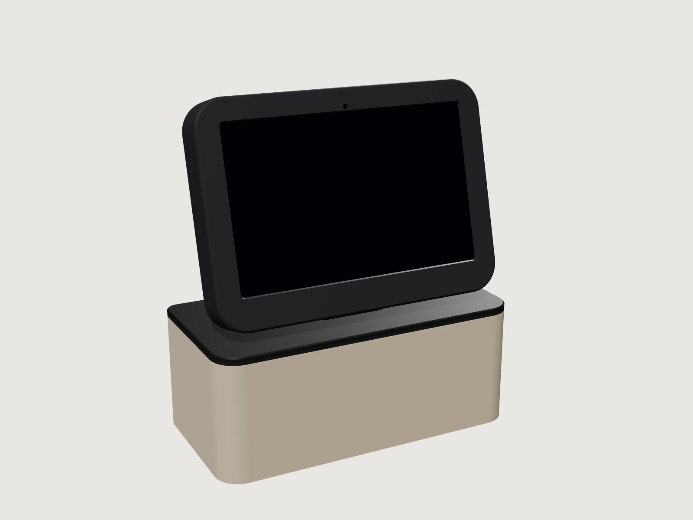
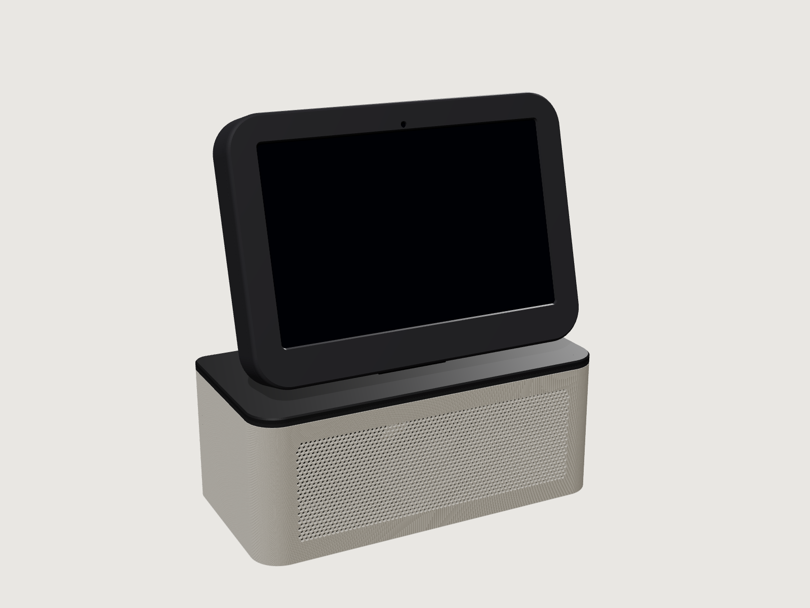
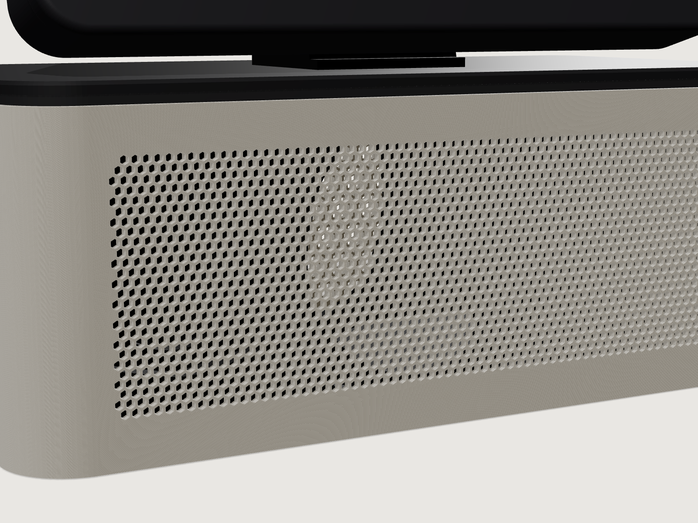
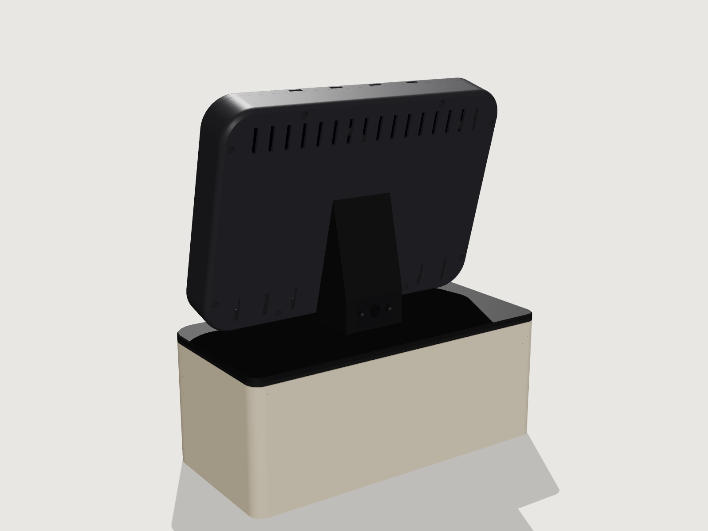
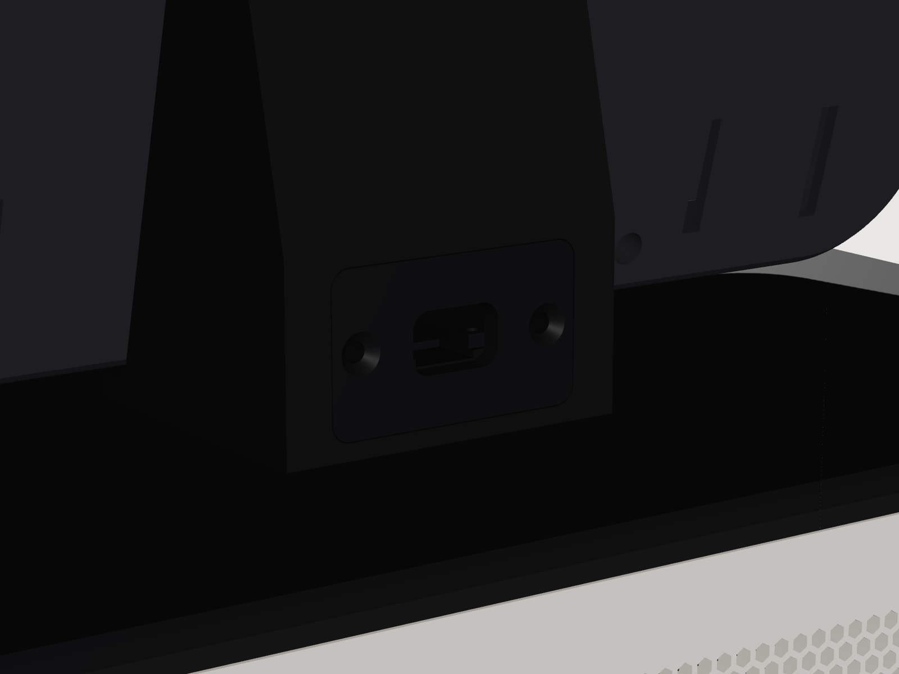
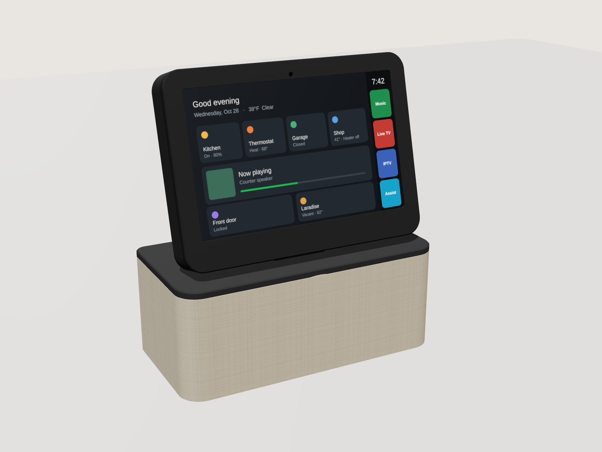
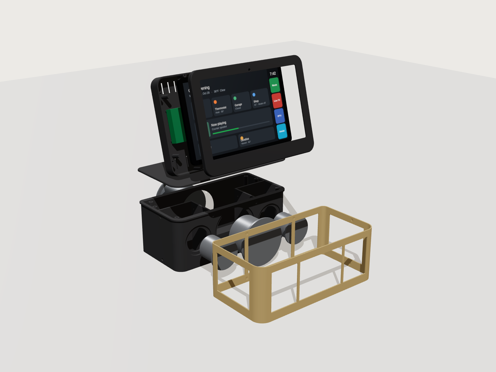
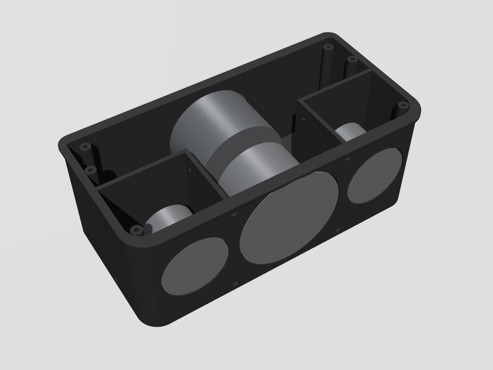
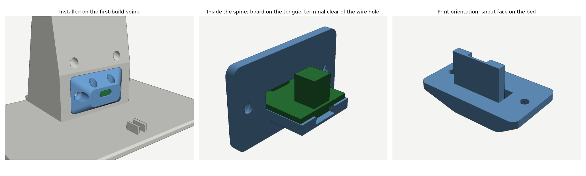
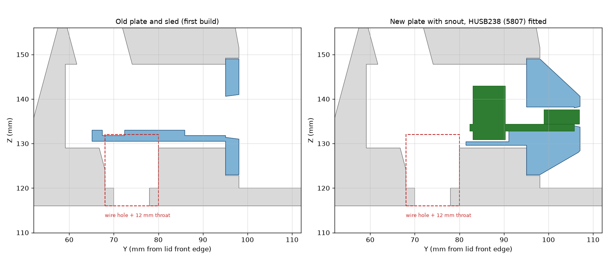

# SmartHub: Counter Display

An open source kitchen-counter smart display and sound system. A Samsung Galaxy Tab A9+ sits in a
tilted 3D-printed bezel on top of a speaker base, which can be wrapped in linen or fitted with a
printed honeycomb grille. A custom Android home app shows a
Home Assistant dashboard full screen with a dock of app tiles. A 24 GHz mmWave radar in the bezel
chin wakes the screen when someone walks up.



|  |  |
| --- | --- |
|  |  |

The `current_*` renders show the current STLs, with the linen base and with the fabric-free grille
shell. The bezel is frameless: the tablet's own black glass border shows, and a 6.8 mm printed rim
wraps its edge with a 1.2 mm lip that overlaps the glass by 1.5 mm. The chin below the screen holds
the radar.

The original Cowork renders show the first version and are kept for reference:

|  |  |  |
| --- | --- | --- |

The full parts list is in [BOM.md](BOM.md).

## How it works

- **Display.** The tablet runs **Counter Home**, a small Kotlin launcher that replaces Fully Kiosk.
  It is the Android device owner, so it can pin itself with lock task mode, turn the panel off and
  set brightness without root. No root means YouTube TV and Spotify keep full DRM.
- **Control.** Counter Home runs a token-protected HTTP API on port 2323. Home Assistant uses it to
  wake, dim, blank and navigate the display.
- **Presence.** A Seeed XIAO ESP32-C3 reads an HLK-LD2410C radar and reports presence to Home
  Assistant over ESPHome. Automations wake the screen, fall back to a dim clock, then turn it off.
- **Sound.** The tablet's USB-C port goes through a flat FPC 90° adapter into a UGREEN 2-in-1 adapter.
  That adapter splits it into a 3.5 mm audio output and a USB-C charging input. A 3.5 mm cable runs
  to the AUX input of a Dayton Audio KABD-430 DSP amplifier in the bezel tray. The amp drives two Dayton ND65
  full-range drivers in sealed side chambers, plus a Dayton ND105 woofer loaded by a rear ND105
  passive radiator.
- **Power.** A small single-port USB-C charger at the wall feeds one thin USB-C cable into a flush
  port on the rear of the spine. Behind the port, a PD trigger board set to 20 V asks the charger
  for 20 V. That feeds the amp directly, a 5 V USB-C converter that charges the tablet through the
  UGREEN adapter, and a small 5 V buck for the ESP32 and radar.
- **Volume cap.** The tablet's media volume sets the amp's input level. Counter Home holds media
  volume at or below a cap, 80 % by default, so the 15 W full-range drivers are not overdriven.
- **Camera.** The tablet's front camera, looking out through the bezel, can act as a security camera
  for Home Assistant. Counter Home serves snapshots and an MJPEG stream through its API, only while
  Home Assistant has turned the camera on, and only if it is allowed on the tablet.

## Repository layout

| Path | What it is |
| --- | --- |
| [`android/`](android) | Counter Home launcher: Kotlin source, Gradle build, `setup.sh` provisioning script |
| `android/CounterHome-1.0.0.apk` | Prebuilt v1.0.0. It predates the volume cap and camera, so build the current version from source |
| [`esphome/counter-presence.yaml`](esphome/counter-presence.yaml) | ESP32-C3 + LD2410C presence sensor firmware |
| [`homeassistant/packages/counter_display.yaml`](homeassistant/packages/counter_display.yaml) | REST commands, status sensors and the wake / ambient / off automations |
| [`homeassistant/auth_trusted_networks.yaml`](homeassistant/auth_trusted_networks.yaml) | Lets the dashboard load without a login screen |
| [`homeassistant/dashboards/counter.yaml`](homeassistant/dashboards/counter.yaml) | The five-view kiosk dashboard the tablet shows |
| [`homeassistant/scripts/`](homeassistant/scripts) | Push the dashboard, create the Gillette calendars, sync the home-game calendars |
| [`homeassistant/calendars/`](homeassistant/calendars) | Gillette Wild home dates (no feed exists), copied into a local calendar |
| [`enclosure/enclosure.py`](enclosure/enclosure.py) | Parametric enclosure model (manifold3d). Generates every STL |
| `enclosure/stl/` | Print-ready STLs, already in print orientation |
| `enclosure/renders/` | `current_*` renders of the current design, plus the original Cowork renders |
| [`BOM.md`](BOM.md) | Bill of materials |
| [`docs/diagrams/`](docs/diagrams) | Assembly and wiring diagrams (PNG and a printable PDF) |

## Build order

### 1. Print the enclosure

The STLs in `enclosure/stl/` are ready to slice. They are the `print_*.stl` outputs of the script,
already oriented for printing.

| Part | Size (mm) | Notes |
| --- | --- | --- |
| `base_tub` | 300 x 150 x 116 | Speaker box with two sealed full-range chambers. Prints floor down, supports only in the outside driver recesses |
| `lid_spine` | 300 x 150 x 119 | Top plate and tilted stand in one piece. Glued to the tub. Prints lid down, no supports |
| `grille_ring` | 299 x 149 x 111 | Linen version. Linen wraps around it. Slides on from below, held by magnets. Prints bottom edge down |
| `grille_shell` | 300 x 150 x 112 | Fabric-free version, instead of the ring and linen. Prints bottom edge down |
| `bezel_shell` | 272 x 197 x 36 | Prints back wall down, front rim on top, no supports. Rim, tablet pocket and tray in one piece |
| `bezel_chin` | 272 x 26 x 9 | Prints back face down, no supports. The chin bar: holds the radar, the lip along the bottom of the glass and the pocket's bottom corners |
| `power_plate` | 44 x 26 x 45 | Prints face down with the sled standing up. Carries the USB-C PD trigger |
| `power_plate_adafruit_first_build` | 44 x 26 x 26 | Only for a lid and spine printed before the HUNSOOL change (spine 55 mm deep at the lid): the plate for the Adafruit HUSB238 breakout (5807). Prints snout face down with the tongue standing up, no supports. See "First-build spine" below |

You need a printer with at least a 300 mm bed axis; a 320 mm or larger bed is more comfortable.
The tablet alone is 257 mm wide, so the bezel cannot fit a 256 mm bed in one piece.
Use PETG or ASA for the bezel shell, because it sits behind a charging tablet and an amplifier.
Do not use carbon-fiber or metal-filled filament for the chin: the radar looks through 1.6 mm of it.

**Frameless bezel.** The front rim and the tray are one part, so there is no seam on the front
above the chin. The tablet slides up into the shell from below, through the slot the chin bar fills.
The chin bar then goes in and is held by four M3 screws from the back of the tray. The bar also
carries the strip of lip along the bottom of the glass, so that strip sits on solid plastic instead
of spanning 255 mm on its own. Because the tablet blocks the inside of the tray, the bezel bolts to
the spine from the spine's rear, through four counterbored holes, into inserts in the tray's back
wall. The pocket is square below the tablet's center, so its rounded corners slide in; the lip
hides the gaps. A slide-in check with a tablet and plug model shows no interference along the path.

**Printing the bezel without supports.** Print the shell back wall down and the chin bar back face
down. Where the rim meets the tray, the inside tapers at 45°, so there is no flat ledge. An overhang
check of both parts in those orientations finds only these spots past 2 mm:
- **Microphone slot tops.** These are 12 mm bridges.
- **Radar window in the chin.** The 1.6 mm of plastic in front of the radar is a 17 x 23 mm bridge,
  held on all four sides. Bridge layers make no difference to the radar.
- **USB-C channel ceiling.** The front rim over the plug channel is a 2.2 mm thick roof, held only
  on the outer wall. It sticks out 5.5 mm, along the 100 mm of the channel. A 45° slope would cut
  into the plug's path as the tablet slides in, so the roof stays flat. The plug clears it by about
  1.1 mm.
- **Bottom corners of the lip.** These belong to the chin bar: solid blocks fill the pocket corners
  outside the tablet's rounded corners and carry the lip's corners. The shell's lip starts 26 mm up
  the sides, where the widest overhang left is 3.1 mm. (On the first build these were thin shell
  tabs that broke easily.)

In PLA these print without supports, with slight sag on surfaces you don't see. **In PETG, support
the lip.** The lip around the window is the last 1.2 mm of the print, and it overhangs the tablet
pocket by 1.9 mm all the way round. PETG droops there, and the last layers can come loose (seen on
a test print). Use painted PETG supports:
- Set the support type to Tree (manual), and paint only these: the underside of the lip all the way
  round the window, the USB-C channel ceiling and the lip just above the chin split at each side.
- Supports are PETG too, so open the gap to make them release: top Z distance 0.25–0.3 mm, two
  top interface layers with no spacing, and no bottom interface. The trees stand on the inside of
  the back wall. Pull them out through the window and the pocket.
- The lip's underside comes out slightly rough. It faces the glass's black border, so it can't be
  seen. Stick thin felt tape on it if you want it softer against the glass.
- A PLA support interface releases more cleanly, but on a single-nozzle H2S every interface layer
  is a filament swap and purge. Even painted this sparingly that is a dozen or so swaps, so it isn't
  worth the time here.

**Back-stop posts.** The tablet's rear camera bump sweeps a vertical lane near the left edge as the
tablet slides up from below, so the six felt-tipped posts stay out of it. The left pair sits at
x = -94, and the bottom of the entry slot has a shallow relief groove for the bump.
- **Strength:** each post has a 3 mm, 45° fillet where it meets the back wall, and a 0.8 mm
  chamfer at the tip so the tablet slides on easily.
- **Camera parameters:** the camera position (`CAM_FROM_LEFT`) and its size (`CAM_D`, `CAM_H`) are
  estimates. Measure your tablet and regenerate.
- **Slide check:** a slide-in check with a tablet and camera-bump model finds no contact.

**Power-key pin hole.** The tablet's side keys sit on its top edge, under the rim. A 2.2 mm hole
through the top rim, over the power key, lets you press it with a paperclip or SIM tool. Use it to
start a tablet that has shut down fully: Samsung tablets don't boot on their own when the charger is
plugged in.
- **Position:** the hole is countersunk on the outside, at the middle of the tablet's thickness,
  49 mm from the tablet's left edge (measured, front view with USB-C on the right; `KEY_FROM_LEFT`).
- **Volume keys:** they get no hole. A forced restart (power and volume down) means taking the
  tablet out. To add one, put `"volume_down"` in `KEY_FROM_LEFT`.
- **Under a mic slot:** if a key sits under one of the four mic slots, no hole is cut for it. Press
  it through the slot.

Settings for the bezel shell and chin bar in PETG on the H2S, 0.4 mm nozzle. Start from Bambu
Studio's profile for your PETG and change these. Both parts fit on one plate, side by side.

| Setting | Bezel shell | Chin bar | Why |
| --- | --- | --- | --- |
| Orientation | Back wall down, as exported | Back face down, as exported | |
| Plate | Textured PEI | Textured PEI | PETG can fuse to smooth PEI. The texture lands on the back faces |
| Nozzle / bed | 240–250 °C / 70–80 °C | Same | Use your filament's profile values |
| Chamber | Unheated | Unheated | Follow Studio if it says to open the door or top vent for PETG |
| Layer height | 0.2 mm, with variable layer height down to about 0.12 mm over the top 4 mm | 0.2 mm | The shell's front face prints last, and its 3 mm round-over steps visibly at 0.2 mm |
| Wall generator | Arachne | Arachne | Prints the 1.2 mm lip, the 1.6 mm cradle walls and radar window, and the label text as solid walls instead of gap fill |
| Wall loops | 3 | 4 | Fills the 2.4 mm tray walls. On the chin, solid walls around the four inserts |
| Top / bottom shells | 5 / 4 | 5 / 4 | |
| Infill | 15 % gyroid | 30 % gyroid | The shell is almost all walls |
| Supports | Painted PETG tree supports: lip, USB-C roof and lip corners, top Z distance 0.25–0.3 mm (see above) | Off | The lip droops in PETG without them |
| Brim | None | 3 mm | The chin is 271 mm long and narrow. The brim lands on its hidden back face |
| Seam | Aligned, on the bottom edge | Aligned, on the bottom edge | Hidden by the chin bar and the base |
| Outer wall speed | About 80 mm/s | About 80 mm/s | A clean front face |
| Top surface | Monotonic lines, no ironing | Same | Ironing tends to drag and smear on PETG |
| Cooling | Profile defaults, bridges at 100 % fan | Same | For the mic slots, the radar window and the USB-C roof |
| Elephant foot compensation | 0.15–0.2 mm | Same | PETG squishes more than PLA |
| Avoid crossing walls | On | On | Less stringing across the labels and cradles |

PETG notes:
- **Dry the filament first,** about 65 °C for 6–8 hours. Wet PETG strings across the vents, label
  text and mic slots, and black shows every blob.
- **USB-C roof supports.** If you need them, don't use PETG supports, because they weld to the part.
  Set the support interface to PLA; the AMS swaps filament for the interface layers, and PLA peels
  cleanly off PETG.
- **Heat-set inserts.** The spine-bolt inserts go in from the shell's back face, and the chin-screw
  inserts into the chin's back face. Both of those faces are first layers. Push the inserts in a
  little below flush, so elephant's foot at the hole mouth doesn't matter.
- **Black filament and the radar.** Black filament is colored with carbon black. That isn't the
  carbon-fiber fill to avoid, and through 1.6 mm it is usually fine at 24 GHz, but some black
  filaments weaken the signal noticeably. Before final assembly, power the LD2410C behind the
  printed chin and compare its distance and presence readings in ESPHome with and without the chin
  in front. If the range drops a lot, print the chin in an uncolored or lighter PETG.
- **PLA+ instead.** It works only if the display stays out of sun and away from the oven. PLA
  softens near 55 °C, and the lip would creep. ASA also works, in the closed chamber with a 5 mm
  brim.

**Printing the tub.** Print it floor down, long side along X. It is laid out so nothing inside the
chambers needs support, so the supports stay outside where you can reach them:
- **Top band.** The band overhangs the grille recess by 3 mm, so its underside is a 45° chamfer
  instead of a flat ledge. The ring and shell tops are beveled to match, with a 0.35 mm gap
  (0.21 mm for the shell). Under the band there is a reveal line of about 1 mm.
- **Mounting rings.** The undersides of the rings inside the chambers taper at 45° down to the floor.
- **Driver cutouts.** These have 45° sides and a flat top that prints as a bridge: 22 mm for the
  ND65s, 39 mm for the woofer and radiator. On the ND65s, the solder-tab opening through the
  mounting face above them is a 32 mm bridge.
- **Woofer and radiator.** Their centers are at Z 56.25, 4.25 mm below the full-range drivers. This
  keeps their recesses under the band chamfer.
- **Bottom edge.** The outer bottom edge has a 0.6 mm chamfer, so elephant's foot doesn't stop the
  ring or shell from sliding on.

Only the arched tops of the four driver recesses, three on the front and one on the rear, need
support. The feet recesses under the floor are 10.5 mm bridges.

Suggested settings for PLA+ on a Bambu H2S, 0.4 mm nozzle:

| Setting | Value | Why |
| --- | --- | --- |
| Supports | Tree (auto), **On build plate only**, threshold 30°, Don't support bridges on | Supports reach the recesses from the plate. Nothing grows inside the chambers |
| Wall generator | Arachne | Prints the 1 mm skins behind the pilot holes and the top land of the ring and shell cleanly |
| Wall loops | 4 (5 if you want margin) | The box must be airtight. The thinnest wall is 1.8 mm, behind the side magnet pockets |
| Top / bottom shells | 5 / 5 | The floor is 5 mm, so it prints solid |
| Infill | 15 % gyroid is fine. 25 % gives a stiffer front baffle | The walls are 7 to 10 mm thick, so infill sets how stiff they are |
| Elephant foot compensation | 0.15 mm | Works with the bottom chamfer |
| Brim | None on textured PEI. Add a 5 mm brim if the corners lift | |
| Seam | Aligned, on the rear | |

When the drivers are in and the lid is glued on, check the seal: push the woofer cone in gently and
let go. It should come back slowly. If it springs straight back, there is a leak. Brush a thin coat
of epoxy or wood glue inside the chambers to seal it.

**Printing the lid and spine.** Print it lid down, as exported, with supports off. Everything
above the lid is either 45° or steeper, or a short bridge:
- The ceiling of the PD trigger cavity is a 25 mm bridge.
- The top of the power plate pocket is a 44 mm bridge, 3 mm deep.
- The dowel holes and the bolt counterbores are small round holes.

Other details:
- **Spine top.** It ends in a 5 mm flat instead of a knife edge.
- **Fit to the bezel.** The face the bezel sits on is 0.2 mm behind the tray back. That way the
  curved bottom edge of the tray can't hold the flat faces apart; the four bolts pull the bezel tight.
- **Lid edge.** The bottom outer edge has a 0.4 mm chamfer, so elephant's foot doesn't leave a lip
  at the joint with the tub.
- **Dowels.** The lid's dowel holes are 2.8 mm deep and the tub's are 4 mm. The 6 mm dowels
  therefore have 0.8 mm of slack and can't hold the lid off the tub.

For PLA+ on the H2S, use the same settings as the tub, either nozzle, but with these changes:
- **Supports:** off.
- **Wall loops:** 4. They give solid walls around the heat-set inserts for the power plate and
  under the bezel bolt heads.
- **Infill:** 20 to 25 % gyroid if you want a stiffer stand. 15 % is enough.

Keep the bed clean so the lid prints flat. The lid's bottom face is the glue joint.

The tray depth follows the amp height, `AMP_H`. Dayton's spec sheet gives 20 mm from the bottom of
the PCB, which makes the tray 27 mm deep and the whole bezel 35.9 mm, down from 39.7 mm.

**First-build spine.** A lid and spine printed before the HUNSOOL change is 55 mm deep at the lid
(the current one is about 67 mm). Use it with the Adafruit HUSB238 breakout (product 5807) and
`power_plate_adafruit_first_build.stl`. The plate is built by `power_plate_first_build.py`, from
Adafruit's CAD model of the board. It replaces an earlier plate for this spine with two problems:
- **Plug jammed.** That plate assumed the socket sat on the PCB's centre line. On the 5807 it sits on
  top of the board, 2.4 mm higher, so the plug's overmold hit the top of the plate's opening.
- **Wire hole covered.** Its sled ran over the lid's wire hole, 74 mm from the lid's front edge, and the
  12 mm throat above it. The speaker wires couldn't get past, and the hole couldn't be sealed.



The new plate works like this:
- **Snout.** A tapered snout stands 9 mm out of the spine's rear face and holds the front of the board.
  The socket's mouth sits 0.2 mm behind the snout's face, in a hole that hugs the receptacle, so the
  plug seats fully against the face.
- **Board.** The board slides in from the inside, USB end first, until its edge stops against the face.
  Two M2.5 x 6 thread-forming screws go down through the two holes on top of the snout, through the
  board's mounting holes, into the floor. A tongue inside the spine carries the board's far end, with a
  slot for the terminal's pins.
- **Wire hole clear.** The board now ends 2 mm behind the wire hole's throat, so nothing sits over it.
  The speaker wires come straight up through the original hole.
- **Same mounting.** It uses the spine's pocket and M3 inserts and the same M3 x 8 countersunk screws.
  The screws go in through wells in the snout's sides.



To fit it:
1. Run the speaker leads up through the original wire hole and the cable channel.
2. With the plate out, hot-glue the hole shut around the wires. Reach in through the open pocket; the
   hole is about 24 mm in from the rear face, at the bottom of the cavity.
3. Screw the board to the plate and put the 18 AWG leads in its terminal. Feed them through the cavity
   and up the channel.
4. Slide the plate in, tongue first, and screw it flush.

If you already drilled the 62 mm hole from the earlier rework, use either hole for the wires and fill
the other with epoxy or hot glue. Both are open from the pocket now. The plug stands 9 mm further back
over the lid than before, closer to the cable clip, so a right-angle plug that points down works best.

**USB-C power plate.** The PD trigger mounts on a sled molded onto the back of the plate, using its
own four mounting holes. The geometry is the HUNSOOL PD3.1 trigger as measured:
- **Board:** 40.3 x 20.5 mm, with the screw terminal at the far end.
- **Socket:** sits on top of the board, its mouth 1.14 mm past the edge.
- **Holes:** front pair 15 mm apart, 4 mm behind the socket mouth; rear pair 15.7 mm apart, 38 mm
  behind it.

The socket sits just behind a 14.4 x 8.8 mm chamfered opening that the plug's molded body passes
through, so the plug seats fully. A cavity in the spine clears the board and its screw terminal and
opens into the cable channel. The lid's speaker-wire hole sits in front of that cavity, so the speaker
wires run straight up the channel past the end of the board instead of having to get past it. The
trigger's terminal, at that end, feeds the same channel. The build script checks both the wires' path
and the plate's slide-in path. The spine's depth follows the board: it is deep enough for the board,
6 mm of wire room behind it and a 3 mm wall to the bezel face. For this board that makes the spine
11 mm deeper than for the shorter Adafruit HUSB238. If you use a different trigger board, change
the `TRIG_*` parameters.
A clip on the lid behind the spine, 32 mm to one side, keeps the charger cable tidy. It sits off the centre line
because the power plate's long sled slides in straight over the lid there. The cable drops from the plug onto
the lid, then runs back through the clip and over the rear edge. A right-angle cable that points down
works best. The clip is sized for a 4.5 mm cable, with two flexible posts and small hooks. Measure
yours and set `CABLE_D`.

**Two base finishes, same tub.** Print either the grille ring and wrap it in linen, or print the
grille shell. The shell is a 2.65 mm printed skin, flush with the tub's top band, with a honeycomb
of 2.6 mm hexagonal holes over the front and rear faces, about 52 % open. The holes point up and
down, so they print cleanly in a vertical wall. The shell uses the same magnets and slides on the
same way as the ring. Set `SHELL_SIDES = True` to perforate the sides too, or change the hole size
and web with `SHELL_HEX` and `SHELL_WEB`.

**Printing the grille shell.** Print it bottom edge down; it needs no supports. The holes have 60°
tops, and the beveled top edge faces up. The bottom edge has a 0.5 mm lead-in chamfer inside and a
0.3 mm chamfer outside. The inner one guides the shell onto the tub and leaves room for elephant's
foot, which would otherwise use up the 0.35 mm clearance. The outer one hides elephant's foot on
the visible edge. That leaves a 1.85 mm wide first layer around an 870 mm loop.

The holes sit over the drivers: 51 % open in front of each ND65 cone and 52 % in front of the woofer
and radiator. The field runs from Z 17 to 98, clear of the magnet pockets at Z 9 and 106 by at least
4.8 mm. The 1.0 mm webs between holes print as two lines.

| Setting | Value | Why |
| --- | --- | --- |
| Supports | Off | Nothing past 45° |
| Wall generator | Arachne | Prints the 1.0 mm webs and the 0.6 mm top land as clean lines |
| Wall loops | 3 or more | Three per side fills the 2.65 mm skin with walls. With two, a 1 mm strip of 15 % infill is left in the middle of the skin |
| Infill | Any; it is all walls | |
| Elephant foot compensation | 0.15 mm | |
| Brim | Inner brim only, about 4 mm, if the first layer doesn't stick. It stays on the hidden inside face | |
| Seam | Aligned, on the rear | |
| Retraction | Profile default; dry the PLA+ first | About 3,600 holes, so there is a lot of travel. Wet filament strings across them |

The grille ring has the same lead-in and the same beveled top. Its window tops are bridges up to
111 mm long. They sag a little, but the linen covers them.

**Driver mounts follow Dayton's drawings and the ND65 3D model.** Each driver sits in a recess
shaped to its frame, deep enough that the surround clears the inside of the covering with room for
excursion: 4 mm for the ND65s, 5 mm for the woofer and 9 mm for the passive radiator. Clearance is
measured to the inner face of the ring or shell, which is closer than the linen, so it holds for
both finishes. A thickened ring behind each
recess carries blind pilot holes on the published bolt circles.

The ND65's solder tabs stand 0.7 mm outside its 52.6 mm cutout and are square-cornered. So each
ND65 recess has an opening through the mounting face above the cutout: 32.8 mm wide, reaching
27.8 mm from the axis, with 45° top corners. The tabs pass through it as the driver goes in, and
the flange still covers it. Behind a 2 mm strip of mounting face, the relief opens up through the
top of the mounting ring for the solder joints and wires. Mount the ND65s with their tabs up.
Fitting Dayton's ND65 model along its whole insertion path shows no contact, with or without the
gasket. The opening's corners come within about 0.5 mm of the flange edge, so the gasket seal there
is thin. Assembly step 4 seals it with glue from inside. Each recess allows for a
1 mm compressed gasket under the flange (`GASKET_T`). The ND105 ear shape is inferred from the
drawing, so its recesses have 1 mm of extra clearance.

**The bezel has raised labels for every component.** On the inside of the tray's back wall, each
cradle is labeled with its board, the amp standoffs say `KABD-430 AMP`, and `USB-C FPC` marks the
spot for the flat USB-C adapter. `LD2410C` sits beside the radar pocket on the back of the chin.
The labels stand 0.6 mm proud and face up in both print orientations. Change them in `CRADLES`, or
turn them off with `LABELS = False`. The script draws them with the DejaVu Sans font bundled with
matplotlib, so the STLs come out the same on every machine.

**Bezel styling is parametric.** `FRAME_SIDE` and `FRAME` set the rim width, `LIP` and
`LIP_OVERLAP` the lip, and `BEZEL_FRONT_FILLET` and `BEZEL_BACK_FILLET` the edge round-overs. The
corner radius follows the rim, so it stays even around the tablet's corners. The back round-over
turns into a 45° chamfer where it meets the print bed. The tray's inner shell follows the outer
curve, so its wall stays 2.4 mm all the way round.

To change dimensions, edit the `PARAMETERS` block in `enclosure.py` and regenerate:

```
pip install -r enclosure/requirements.txt
python enclosure/enclosure.py enclosure/out
```

The first-build power plate has its own script, which also checks its fit against the first-build spine:

```
python enclosure/power_plate_first_build.py enclosure/out
```

The script prints part volumes and the air volume of each chamber: about 0.54 L per full-range
chamber and 2.65 L for the woofer chamber, before subtracting the drivers. Those volumes assume a
closed box, so it also prints the open area through the lid. That should be only the 8 mm speaker
wire hole (50.3 mm²), which you seal with hot glue during assembly. Copy the `print_*.stl` files over the ones in `enclosure/stl/`.

### 2. Assemble

The assembly diagrams in [`docs/diagrams/`](docs/diagrams) go with these steps. They are also in one
printable file, [`assembly_diagrams.pdf`](docs/diagrams/assembly_diagrams.pdf).

| Sheet | Shows |
| --- | --- |
| [1. General assembly](docs/diagrams/1_general_assembly.png) | How the bezel, lid and spine, tub, drivers and grille shell fit together |
| [2. Base and spine](docs/diagrams/2_base_and_spine.png) | Rear view: passive radiator, power plate, PD trigger, bolts, dowels, magnets, cable clip |
| [3. Bezel assembly](docs/diagrams/3_bezel_assembly.png) | Tray contents, felt pads, tablet and FPC adapter, chin bar and radar |
| [4. Wiring](docs/diagrams/4_wiring.png) | Every circuit, with wire gauges and colors, splices and sealed pass-throughs |


1. Press the M3 heat-set inserts in: four into the back face of the chin bar, four from the back into
   the shell's spine-bolt bosses, and two into the power plate pocket on the spine's rear face.
2. Glue a 6 x 2 mm magnet into each of the 12 tub pockets and a 6 x 1 mm magnet into each ring
   or shell pocket. Check polarity before the glue sets. The tub magnets sit 0.2 mm below the surface and the
   ring magnets sit flush.
3. Cut three pairs of speaker wire, one each for the woofer and the two full-range drivers. Each pair
   runs from its driver out through the lid and up the spine's cable channel, so make it long enough
   to reach the amp in the tray with 10 cm to spare. With the lid off the tub, push the pairs up
   through the 8 mm hole in the lid from underneath until they come out of the top of the channel.
   Pass the full-range pairs through the chamber holes. Seal the chamber holes and the lid hole with
   hot glue around the wires, from the inside. Fill the lid hole completely. It opens into the woofer
   chamber, and any gap left there acts as a port and spoils the passive radiator tuning.
4. Mount the drivers from the outside on 1 mm gasket tape with M3 x 6 screws in the pilot holes.
   Lay the tape around the outer edge of each mounting face, under the flange.
   - **Woofer and radiator:** wire them first.
   - **ND65s:** put them in unwired, tabs up, so the tabs pass through the opening above the
     cutout. Solder blobs on the tabs won't fit through it. Solder the leads afterwards, reaching in
     through the open top of each full-range chamber; the lid isn't on yet.
   - **Seal each ND65 opening:** run a bead of hot glue or silicone from inside, along the top of
     the opening where the flange covers it. The opening's corners come within about 0.5 mm of the
     flange edge, so the gasket alone won't seal them.
5. Add light stuffing, then glue the lid to the tub using the six dowels for alignment. The joint must be airtight.
   Run epoxy along the tops of the two full-range chamber walls as well as the outer rim, so each chamber seals on its own.
6. Linen version: cover the outside of the grille ring with linen (below), then slide the ring onto
   the tub. Fabric-free version: slide the grille shell onto the tub from below.

**Covering the grille ring.** The linen goes on the outer face only. The ring's outer face sits 0.6 mm
inside the tub's top band, so the fabric finishes flush with the band. There's no room to fold it
over an edge:
- Inside, the ring clears the tub by 0.35 mm.
- At the top, the beveled edge clears the band's chamfer by about the same.
- Trim the fabric flush at the top and bottom edges instead.

1. Iron the linen flat. Cut a strip about 900 x 130 mm with the weave square to the edges. The ring
   is about 866 mm around and 111 mm tall on its outer face.
2. Run a thin bead of fabric glue or Fray Check along a straight thread, about 3 mm in from one short
   end. That end becomes the visible edge of the seam.
3. Lightly mist the ring's outer face with spray adhesive. Spray the ring, not the fabric. Any glue on
   the linen over the windows clogs its weave and muffles the drivers. Overspray just passes through
   the open windows.
4. Start at the rear right corner, a solid part of the ring away from the windows. Lay the linen on
   with the weave level and keep it taut across the windows as you work around. Smooth it onto the
   solid rails and posts only.
5. Finish back at the rear right corner. Overlap the sealed end about 10 mm, cut through both layers
   with a fresh blade and peel out the offcut, so the ends butt without a double layer. Press the seam
   down.
6. Once the glue has set, trim the top and bottom flush with the ring edges, using a fresh blade held
   against the plastic. Seal both cut edges with a thin line of Fray Check.
7. Check the fit before the glue fully cures. The ring should slide on from below without the fabric
   catching. The linen's top edge should sit just under the band, with the face flush.
7. Set the PD trigger's DIP switches to 20 V, using the voltage table printed on the board. Never
   use 28 V: the amp's maximum is 26 V. Screw the board to the power plate's sled, USB-C socket toward the opening:
   - **Front holes (by the USB port, 3.6 mm):** two M3 x 6 thread-forming screws.
   - **Rear holes (1.8 mm):** two M1.7 x 5 self-tapping screws. These are optional; the front pair
     holds the board. Put 18 AWG
   leads in its screw terminal, feed them through the cavity and up the cable channel into the tray,
   then screw the plate flush with two M3 x 8 countersunk screws. Before connecting the amp, plug in
   the charger and check for 20 V at the leads. Press the charger cable down into the clip on the lid.
8. With the bezel shell off the stand and face down, mount the amp on its standoffs. Screw the 5 V USB-C
   converter label out onto its two bosses with M3 x 8 thread-forming screws. Its wires and USB-C
   cable leave the bottom edge. Stick the UGREEN adapter, 5 V buck and ESP32-C3 into their cradles
   with VHB tape. Bring the speaker and power
   leads from the top of the spine's cable channel in through the cable hole in the back wall.
9. Plug the flat FPC 90° adapter into the tablet. Connect the UGREEN adapter to it, the 5 V converter's plug to the
   UGREEN charging port, and the 3.5 mm cable from the UGREEN audio jack to the KABD-430 AUX input (J13).
   Some Dayton documents call the analog input J5, but J5 is the programming port; check the silkscreen.

   **AUX lead.** The 3.5 mm jack isn't on the board. J13 is a 5-pin JST PH (2.0 mm) header, from
   Dayton's manual: pin 1 Left in, 2 AGND, 3 Right in, 4 and 5 not connected. Pin 1 is at the end
   with the triangle on the silkscreen. Either use the jack lead from Dayton's functional cable kit,
   or make one:
   - Cut a 3.5 mm stereo cable: tip (left) to pin 1, sleeve (ground) to pin 2, ring (right) to pin 3.
   - Use a pre-crimped 5-pin JST PH pigtail.

   By default the DSP mixes AUX and Bluetooth, so a phone can play over Bluetooth while the tablet
   stays on AUX. Bluetooth holds one device at a time and shows as "DAKAB". If you load a custom DSP
   program, keep both inputs in its mix.

   **Optional extras:**
   - **J2, pairing button:** the green momentary button. Hold it about a second to pair a new device;
     this drops the old one. Don't hold it past 5 seconds.
   - **J1, status LED:** 2-pin PH, pin 1 LED−, pin 2 LED+. It blinks while searching and stays on
     when connected.
   - **Mounting:** both are only needed when you pair a new phone. Leave them in the tray, or fit
     them through a hole drilled in the tray's back wall, where you can reach them from behind.
   - **J10:** the standby switch port. Leave it empty.

   **Amp outputs, wired for 2.1.** The KABD-430's two speaker connectors, J11 and J12, are 6-pin. Its
   harness plugs have four bare leads (pins 3–6) and a two-pin jumper (pins 1 and 2, GND and MODE).
   The jumper sets each connector's mode:
   - **J11, stereo, jumper plugged in:** the two full-range drivers.
     - Pin 5 to the left ND65's + and pin 6 to its −.
     - Pin 4 to the right ND65's + and pin 3 to its −.
     - Left is the driver on your left as you face the display.
   - **J12, mono (bridged), jumper left open:** the woofer. Pins 3 and 4 are both MONO+, and pins 5
     and 6 are both MONO−. Join 3 with 4 and 5 with 6 at the plug, then run one pair to the woofer.
     That way only six conductors go down the spine and through the lid hole. The ND105-4 is 4 Ω,
     the minimum the amp allows in either mode.
   - **Power:** the centre connector, red + and black −, from the 20 V splices.
   - **Rules:** change the jumpers only with the power off, and never let speaker leads touch while
     it's running.

   The bridged channel plays whatever the DSP sends it. Load a 2.1 program through J5 with the KPX:
   a low-pass on J12 for the woofer, a matching high-pass on J11, and the woofer level trimmed to
   suit. Then check each driver plays the right range before closing up. The pin numbers come from
   Dayton's quick-start wiring guide; match them to the pin-1 mark on the board's silkscreen.
10. Put 0.5 mm felt pads on the six back-stop posts. Slide the tablet up into the shell from the bottom,
    glass toward the lip, with the FPC plug riding in the channel on the right.
11. Fit the radar into the chin bar's pocket, push the bar straight back into its slot below the tablet (its
    corner blocks fill the gaps beside the tablet's bottom corners), run the
    radar wires up to the ESP32-C3, and screw the bar on from the back of the tray with four M3 x 20 screws.
12. Tuck the slack in the leads back down the spine's cable channel, then bolt the bezel to the spine
    from the spine's rear with four M3 x 16 bolts.

The flat FPC adapter has to fit within 4 mm of the tablet's edge (`USB_CLEAR`). If yours sticks out
further, raise `USB_CLEAR` and `FRAME_SIDE` together and regenerate the bezel.

If you hear hum or charging noise through the speakers, add a 3.5 mm ground loop isolator in the
audio cable. The tablet charger and the amp share one supply, which can create a ground loop.

### 3. Flash the presence sensor

```
cd esphome
esphome run counter-presence.yaml
```

The first flash needs USB; after that updates go over the air. Wiring is at the top of the YAML.
The board is a Seeed XIAO ESP32-C3 (`board: seeed_xiao_esp32c3`):
- **Flashing:** if the port doesn't appear, hold its BOOT button while plugging it in.
- **Antenna:** it has no on-board antenna. Plug in the U.FL antenna that comes with it, and stick
  the flat antenna inside the tray, away from the amp and the tablet's metal back.
- **Power from the buck:** the 5 V feed goes to its 5V pin through a Schottky diode, so plugging in
  USB while the 20 V supply is on can't back-feed the buck.
It needs `counter_presence_api_key`, `ota_password`, `wifi_ssid` and `wifi_password` in your
ESPHome `secrets.yaml`. Suggested radar tuning is in the YAML comments.

### 4. Provision the tablet

1. Build Counter Home v1.2.1, as described in [Building the app](#building-the-app). `setup.sh`
   installs that build when it exists, and otherwise falls back to the prebuilt v1.0.0, which has no
   volume cap or camera.
2. Factory reset the tablet. Connect Wi-Fi, skip every Google and Samsung sign-in, and turn on
   developer options. Device owner can only be set while the tablet has no accounts.
3. Connect adb. In the finished enclosure the tablet's only USB-C port feeds the audio adapter, so
   use wireless debugging with the computer on the same Wi-Fi. Turn on Settings > Developer options >
   Wireless debugging, tap "Pair device with pairing code", then:

   ```
   adb pair <tablet_ip>:<pairing_port>
   adb connect <tablet_ip>:<port>
   ```

   The connect port is the one on the Wireless debugging screen, not the pairing port.
4. On your computer, with Android platform-tools installed:

   ```
   cd android
   ./setup.sh http://<HA_IP>:8123/dashboard-counter/0?kiosk
   ```

   It installs the APK, makes Counter Home the device owner, removes bloat, and prints the
   tablet IP, the API token and the Home Assistant secrets. Reserve that IP on your router.
5. On the tablet, hold the dock clock for 3 seconds and enter PIN `2580`. Choose
   "Pause kiosk lock and open Android settings". Sign in to Google, install Spotify, YouTube TV,
   an IPTV player such as OTT Play and the Home Assistant app, set Battery protection to Maximum, and make Home
   Assistant the default digital assistant. Then tap "Resume kiosk lock".
6. Change the settings PIN. The default PIN is public in this repository.
7. Set the volume cap by ear. Play music with bass at the cap, and lower "Max media volume" in the
   settings screen if the full-range drivers distort or bottom out.
8. To use the camera, tick "Allow the camera" in the settings screen. It stays off until Home
   Assistant turns it on. Also check that Android's camera access toggle is on: Settings > Security
   and privacy > More privacy settings > Camera access. When it's off, every frame comes out black.

**HTTPS dashboards by LAN IP.** If Home Assistant is HTTPS-only with a certificate for a public
name, such as a DuckDNS address, the tablet usually can't reach that name from the LAN: most routers
don't loop the public address back in. Load the dashboard by Home Assistant's LAN IP instead, and set
"Certificate name" in the settings screen (`haCertName` in `POST /config`) to the name on the
certificate. Counter Home then accepts the certificate for that IP only when it names that host and
is otherwise valid: trusted, in date, and for the configured dashboard host. At provisioning time:

```
HA_CERT_NAME=myhome.duckdns.org ./setup.sh https://192.168.0.50:8123/dashboard-counter/0?kiosk
```

A local DNS entry that points the public name at the LAN IP also works, with no setting needed.

**Debloat.** `setup.sh` runs `debloat.sh`, which removes about a hundred Samsung, Google, Microsoft
and Meta apps listed in `android/debloat-packages.txt`. It keeps Play services, the Play Store,
Android System WebView, Chrome, One UI Home, Samsung Keyboard and Device care; the list's header
says why each stays. Removal is per user, so `/system` is untouched. Preview with
`./debloat.sh --dry-run`, put one app back with `./restore.sh <package>`, or everything with
`./restore.sh --all`. A factory reset, and sometimes a major One UI update, brings the apps back;
rerun `./debloat.sh` after an update.

Do the YouTube TV and Spotify sign-ins while the kiosk lock is paused. Google's login screens
belong to other packages, and lock task mode blocks them.

The KABD-430 still has Bluetooth, and its default DSP program mixes Bluetooth audio with the AUX
input. Anyone in range can pair a phone with it. A custom SigmaStudio program, loaded with a Dayton
ICP1 or KPX programmer, can drop the Bluetooth input.

### 5. Configure Home Assistant

1. Copy `homeassistant/packages/counter_display.yaml` into `config/packages/` and enable packages in
   `configuration.yaml`.
2. Add the three secrets `setup.sh` printed to `secrets.yaml`:
   `counter_display_token`, `counter_display_api` and `counter_display_status`.
3. Merge `homeassistant/auth_trusted_networks.yaml` into the `homeassistant:` block. Create a non-admin
   `counter` user and put its user ID and the tablet IP in the snippet.
4. Install the HACS "kiosk-mode" plugin so `?kiosk` hides the header and sidebar, then restart Home Assistant.

The automations expect the presence entity `binary_sensor.counter_presence_presence`, which the
ESPHome config creates.

**The dashboard.** [`homeassistant/dashboards/counter.yaml`](homeassistant/dashboards/counter.yaml)
is the `dashboard-counter` dashboard the tablet loads: five views for an 11" landscape screen in
kiosk mode, each starting with the same row of navigation chips because the kiosk hides HA's tabs.

| View | What's on it |
| --- | --- |
| Home | Clock and forecast, the two garage doors and the gate as big tap tiles with their open/closed state, gate camera, house thermostat, fireplace, hot tub and security summaries, the next few calendar events |
| Hot Tub | Set point, water and heater temperatures, jets, light colours, salt system, locks and clean cycle, 24 h graphs |
| Lights | Every light by room, dimmer sliders, the Normal / Go Bills / Go Pokes scenes, an "everything off" button |
| Security | Locks, alarm panel, every door and window sensor, four cameras |
| Calendar | Month view plus a "coming up" list of the household and Gillette calendars |

It needs the HACS cards `mushroom`, `clock-weather-card`, `mini-graph-card` and `kiosk-mode`
(the dashboard's `kiosk_mode:` block hides the header and sidebar for non-admin users, so the
tablet's `counter` user stays in kiosk mode when it switches views). The scripts in
[`homeassistant/scripts/`](homeassistant/scripts) talk to Home Assistant with a long-lived access
token, read from `HA_TOKEN` or from `ha_token:` in the git-ignored `android/keystore/ha-secrets.yaml`
(`pip install websockets pyyaml pillow` first):

```
python3 homeassistant/scripts/push_dashboard.py     # save counter.yaml as dashboard-counter, reload the tablet
python3 homeassistant/scripts/setup_calendars.py    # create the Gillette community calendars (idempotent)
python3 homeassistant/scripts/sync_home_games.py    # fill the Pronghorn and Gillette Wild home-game calendars
python3 homeassistant/scripts/set_wallpaper.py      # upload the wallpaper and set it as every view's background
```

The wallpaper is a dark mesh gradient rendered by
[`homeassistant/dashboards/wallpaper/make_wallpaper.py`](homeassistant/dashboards/wallpaper/make_wallpaper.py);
`set_wallpaper.py` puts the PNG in Home Assistant's image store (served without a login, so the
kiosk user can load it) and writes its URL into each view's `background:`. To use your own picture,
`set_wallpaper.py path/to/image.jpg` then `push_dashboard.py`.

`setup_calendars.py` subscribes Home Assistant's built-in Remote Calendar integration to the
Campbell County events and Rockpile Museum feeds (campbellcountywy.gov) and the Gillette College
events feed, which update themselves. The two sports calendars are Local Calendars:
`sync_home_games.py` reads the college's PrestoSports iCal feeds and keeps only games at the
Pronghorn Center, and copies the Gillette Wild home dates from
[`homeassistant/calendars/gillette_wild_home.yaml`](homeassistant/calendars/gillette_wild_home.yaml)
(the NA3HL site has no feed, so that file is updated by hand each season). Re-run it when a
schedule changes; it only adds what's missing.

The shared household calendar is a Google calendar. The Google Calendar integration needs its own
OAuth client: in the [Google Cloud console](https://console.cloud.google.com) create a project,
enable the Google Calendar API, configure the OAuth consent screen (External, add yourself as a
test user) and create an OAuth client ID of type "Web application" with
`https://my.home-assistant.io/redirect/oauth` as the redirect URI. Then in Home Assistant go to
Settings > Devices & services > Add integration > Google Calendar, paste the client ID and secret,
and sign in. Add the resulting `calendar.*` entity to the two calendar cards and the "Coming up"
card in `counter.yaml` and push again. `homeassistant/dashboards/previous/` keeps the dashboard that was
replaced.

| Time with nobody present | What happens |
| --- | --- |
| Someone arrives | Screen on. Brightness 25 from 22:00 to 06:00, auto otherwise |
| 2 minutes | Dim clock overlay, if the dashboard is in front |
| 10 minutes | Panel off, if the dashboard is in front |
| 30 minutes | Back to the dashboard and panel off, if another app was open |

A notification fires if the tablet battery stays above 42 °C for 5 minutes.

### 6. Camera in Home Assistant (optional)

1. Tick "Allow the camera" in Counter Home settings on the tablet.
2. In Home Assistant, go to Settings > Devices & services > Add integration > MJPEG IP Camera, name it
   `Counter display` and use:

   ```
   MJPEG URL:        http://<tablet_ip>:2323/camera.mjpeg?token=<token>
   Still image URL:  http://<tablet_ip>:2323/camera.jpg?token=<token>
   ```

   That creates `camera.counter_display`.
3. The package's camera automations then do three things:
   - turn the camera on five minutes after everyone has left, using `zone.home`, so it needs person entities with device trackers
   - turn it off as soon as someone is home
   - when the radar sees someone while nobody is home, take a snapshot to
     `/config/www/counter_display/last_motion.jpg` and post a notification with the picture

   Uncomment the `notify.mobile_app_...` lines for a phone push.

To check on the house from away, open the camera in the Home Assistant app over Nabu Casa or a VPN
to your EdgeRouter. Never forward port 2323 to the internet.

**What to expect from the camera:**
- **Privacy indicator.** A red `● CAM` shows in the dock whenever the camera runs. The API can turn it
  on and off but cannot change "Allow the camera"; only the settings screen behind the PIN can.
- **Explicit control.** Snapshots and streams fail with "camera is off" unless Home Assistant has
  turned the camera on. A dashboard that refreshes the camera picture never switches it on by itself.
- **No night vision.** In the dark the picture is black. The wake automation turns the screen on
  when the radar sees someone, which lights the counter a little; a light turned on by an automation works better.
- **One app at a time.** While the camera runs, other apps can't use it, so video calls fail. Turn it off first.
- **Heat.** Streaming warms the tablet. The battery temperature alert covers it, but don't stream around the clock.
- **Rear camera.** `cameraFacing: back` works in software, but that camera sits behind the bezel tray and sees nothing unless you cut an opening.
- **Not yet tested on a device.** This version compiles against the Android 14 framework but hasn't run on a tablet yet.

## Counter Home API

Every call needs `Authorization: Bearer <token>` or `?token=<token>`. Port 2323.

| Call | Does |
| --- | --- |
| `GET /status` | JSON: screenOn, ambient, launcherInFront, deviceOwner, kioskPaused, battery, charging, batteryTempC, volume, maxVolume, cameraAllowed, camera, ip |
| `POST /screen/on`, `/screen/off`, `/screen/toggle` | Panel power |
| `POST /ambient/on`, `/ambient/off` | Dim clock overlay, tap to dismiss |
| `POST /home` | Back to the dashboard from any app |
| `POST /launch?app=Music` | Tile label or package name |
| `POST /assist` | Opens the default assistant (HA Assist) |
| `POST /navigate?url=...` | Load any URL in the dashboard view, such as a camera page when the doorbell rings |
| `POST /brightness?value=0-255` or `?value=auto` | Backlight |
| `POST /reload` | Reload the dashboard |
| `POST /volume?value=0-100`, `/volume/up`, `/volume/down` | Media volume as a percentage, never above the cap. Returns the new `volume` |
| `POST /camera/on?minutes=N` | Camera on. With `minutes`, it turns itself off after that long. Needs "Allow the camera" |
| `POST /camera/off` | Camera off |
| `GET /camera.jpg` | Latest frame as JPEG. 503 while the camera is off |
| `GET /camera.mjpeg` | MJPEG stream, up to 3 at once. It ends when the camera turns off |
| `GET /config`, `POST /config` | Read or change settings as JSON: haUrl, haCertName, tiles, dockSide, kioskLock, maxVolume, cameraFacing, cameraWidth, cameraFps, cameraQuality, cameraRotation, pin, port |

`volume` and `maxVolume` are percentages of the tablet's media volume range.

`camera` in `/status` reports `running`, `facing`, `width`, `height`, `frameAgeMs`, `offInSeconds`
and the last `error`. Camera defaults: front camera, up to 1280 px wide, 5 frames per second, JPEG
quality 70. `cameraRotation` -1 follows the screen orientation; 0, 90, 180 or 270 force it.

Quick test from any machine on the LAN:

```
curl -H "Authorization: Bearer <token>" http://<tablet_ip>:2323/status
```

Example tiles JSON, for the settings screen or `POST /config`:

```json
{"tiles": [
  {"label": "Music",   "package": "com.spotify.music", "color": "#1F8F4E"},
  {"label": "Live TV", "package": "com.google.android.apps.youtube.unplugged", "color": "#C43B33"},
  {"label": "IPTV",    "package": "com.ottplay.ottplay", "color": "#3A62B8"},
  {"label": "Volume",  "action": "volume", "color": "#5B6470"},
  {"label": "Assist",  "action": "assist", "color": "#16A3C9"}
]}
```

Tile actions are `assist`, `reload`, `home`, `volume`, `volume_up` and `volume_down`. `volume`
opens Android's media volume slider over whatever is on screen.

**Volume without side keys.** The bezel covers the tablet's volume keys, so volume comes from three
places: the Volume dock tile, the `input_number.counter_display_volume` slider that the Home
Assistant package adds (put it on the dashboard), and `POST /volume`. All three respect the cap.
While Spotify or another app fills the screen the dock is hidden; use the slider in Home Assistant,
or turn on Samsung's floating Assistant menu (Settings > Accessibility > Interaction and dexterity),
which has volume buttons. The dock can sit on the right, left or bottom.

## Building the app

You need JDK 17+ and the Android SDK with platform 34. Point `android/local.properties` at the SDK
with `sdk.dir=/path/to/Android/sdk`, then:

```
cd android
./gradlew assembleRelease
adb install -r app/build/outputs/apk/release/app-release.apk
```

The app has no dependencies beyond the Android framework and the Kotlin stdlib.

**The signing keystore is not in this repository.** The repository is public, and anyone holding the
key could sign an update that replaces the device-owner app. Copy your `counterhome.jks` into
`android/keystore/` before building; that folder is git-ignored. Without the keystore the release
APK builds unsigned. Updates must be signed with the same key, or Android refuses to install them
over the device-owner app, and replacing a device owner takes a factory reset. Back the keystore up.

Store and key passwords default to the values the keystore was created with. Override them with the
Gradle properties `counterhome.storePassword`, `counterhome.keyAlias` and `counterhome.keyPassword`,
for example in `~/.gradle/gradle.properties`.

## Undo

Open the settings screen and choose "Release device owner". The tablet goes back to being a normal
Android tablet. A factory reset also clears it.

## Design review status

These items came out of reviewing the Cowork export.

| Item | Status |
| --- | --- |
| Magnet pockets too shallow for one 3 mm magnet each side | Fixed. Pockets now fit a 6 x 2 mm tub magnet and a 6 x 1 mm ring magnet |
| No room for a USB-C plug past the tablet edge | Fixed. A flat FPC 90° adapter in a 4 mm channel beside the tablet |
| No mounts for the small boards in the tray | Fixed. Cradles for the PD module, UGREEN adapter, 5 V buck and ESP32-C3 |
| No pilot holes for the driver screws | Fixed. Blind pilots on Dayton's published bolt circles: 66 mm for the ND65, 108.5 mm for the ND105 pair |
| Woofer and passive radiator surrounds stood 3 to 4 mm proud of the fabric | Fixed. Every driver sits in a recess shaped to its frame, with excursion clearance to the covering |
| Driver clearance was measured to the linen, but the grille ring's rails sit 2.25 mm closer | Fixed. Clearance is measured to the inner face of the ring or shell |
| Full-range drivers can be overdriven | Fixed in the app with a media volume cap, 80 % by default. Tune it by ear |
| Four non-manifold edges in `base_tub` | Fixed. Two brace columns now overlap the side walls instead of touching them |
| Needs a 300 mm print bed | Not changed. The tablet is 257 mm wide, so a smaller bed would need a split bezel |
| Setup script printed the wrong Home Assistant secret names | Fixed |
| KABD-430 amp is taller than the original tray allowed | Fixed. Tray depth follows the amp height: 27 mm for the 20 mm board on Dayton's spec sheet |
| Wide printed frame covered the tablet's glass, light sensor and camera | Changed to a frameless bezel: a thin rim, the tablet glass showing, and a one-piece shell plus chin |
| First-build spine: the USB-C plug's overmold hit the power plate's opening, and the trigger's sled covered the lid's wire hole so it couldn't be sealed | Fixed with a new plate for the Adafruit HUSB238 (5807). A snout 9 mm out of the spine holds the socket at the face and carries the board clear of the wire hole |
| 24 V entered through a pigtail hole | Changed to a flush USB-C port on a screw-in plate, powered by a small USB-C charger |
| The 12 mm lid hole left the woofer chamber open to the bezel tray through the cable channel, which spoiled the passive radiator alignment | Fixed. The hole is 8 mm, sized for three 20 AWG pairs, the channel no longer cuts through the lid, and assembly step 3 seals the hole with hot glue |
| Bezel shell: the two small lip tabs at the bottom corners of the window break easily (first PETG build). They are 1.2 mm thick, held on two sides, and sit over the gaps that let the tablet's corners slide in | Fixed for the next build (first build works as printed). The chin bar now runs up to `CHIN_SPLIT` (26 mm), where the corner blocks are still 1.5 mm thick at the pocket wall. It carries solid blocks that fill the pocket corners outside the tablet's rounded corners, with the lip's corners on their front. Checked: the bar slides straight back into place past the seated tablet without contact |
| Power: the tablet's 5 V comes from its own converter (E6), separate from the MP1584 buck (E5) | Works as built. For a future build, use one 5 A, 20 V to 5 V buck for all three loads: the XIAO through its diode, the radar, and a USB-C plug lead with a 10 kΩ CC pull-up for the tablet. The MP1584 alone is too small for tablet charging (2–3 A) in the warm tray, and a USB-C plug with no CC pull-up delivers no power |
| Bezel shell: the four chin-screw bosses stood off the back wall with about 4 mm of air above the tray floor (first build) | Fixed for the next build. Each boss sits on a solid 9 mm pedestal down into the tray floor, so it is tied to the floor and the back wall. The tablet's and the camera bump's slide-in paths are still clear |
