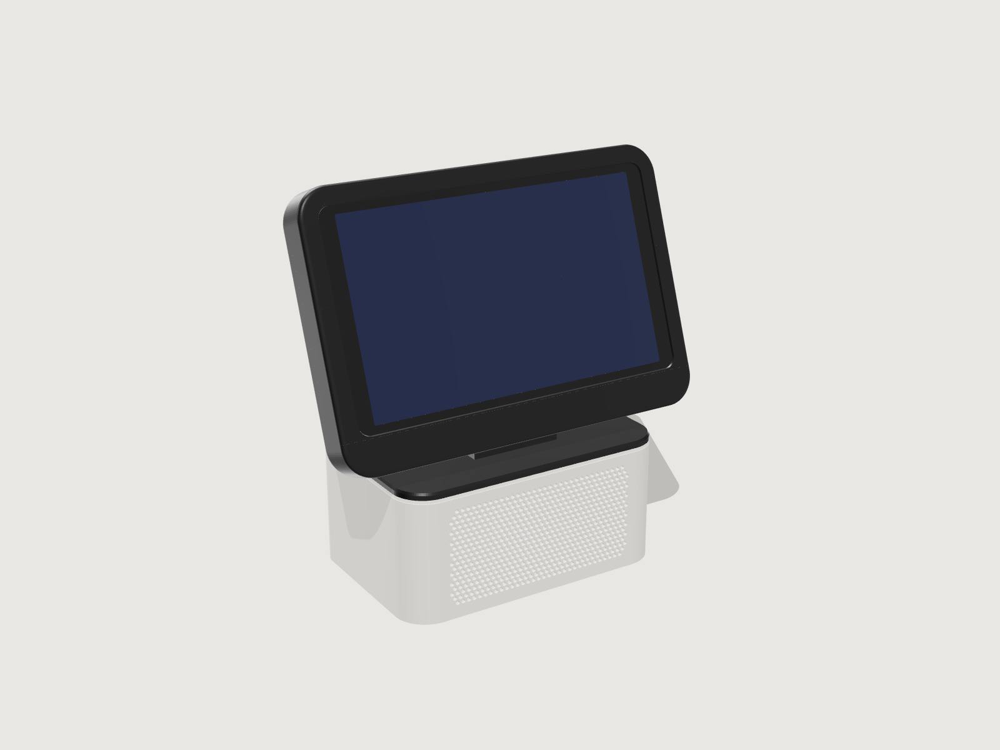
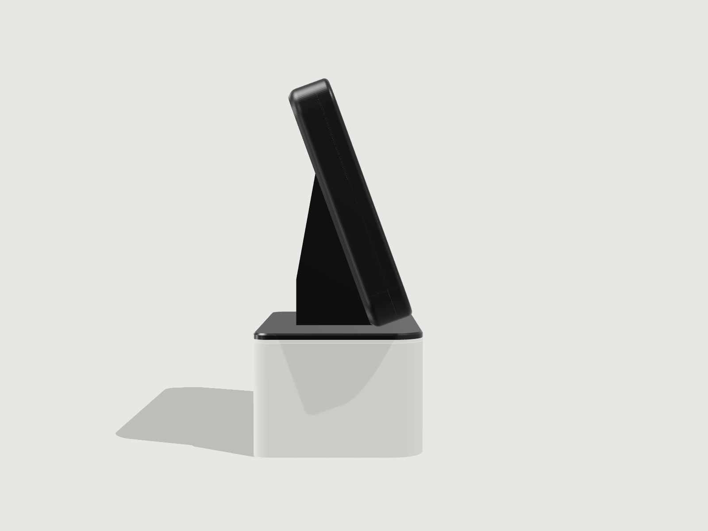
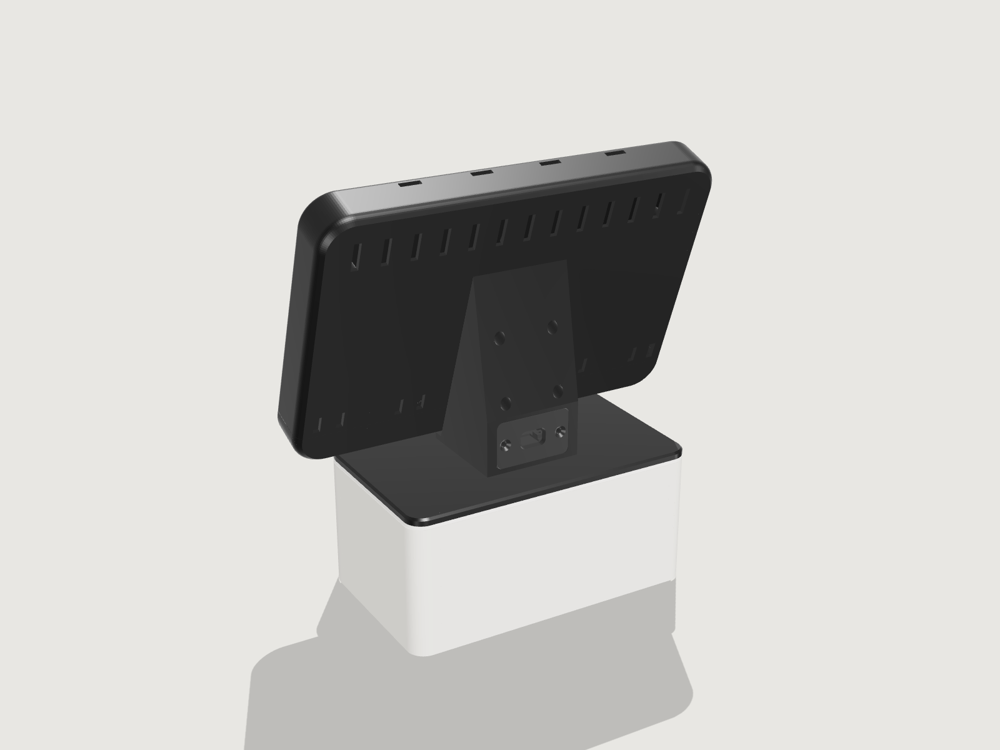
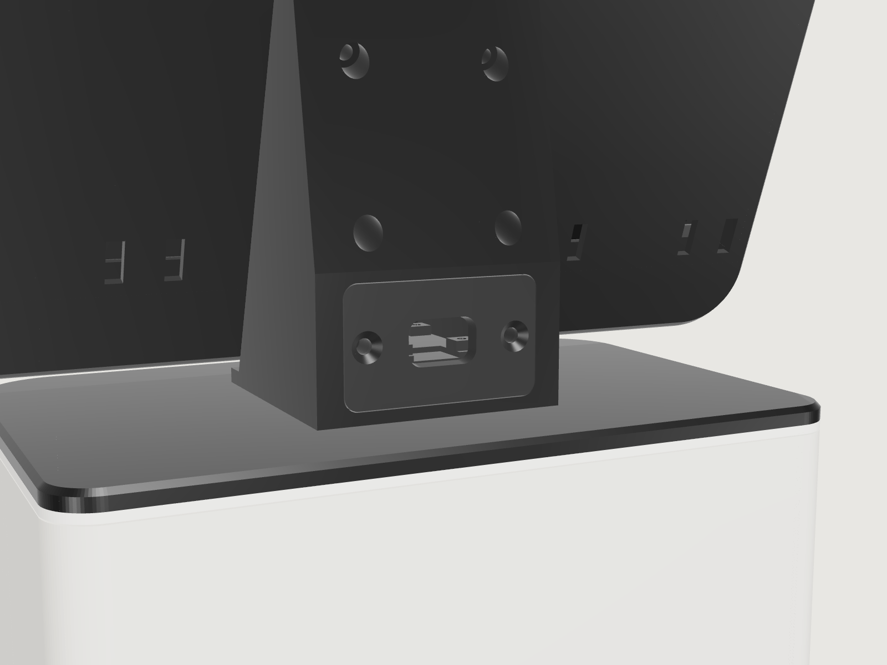
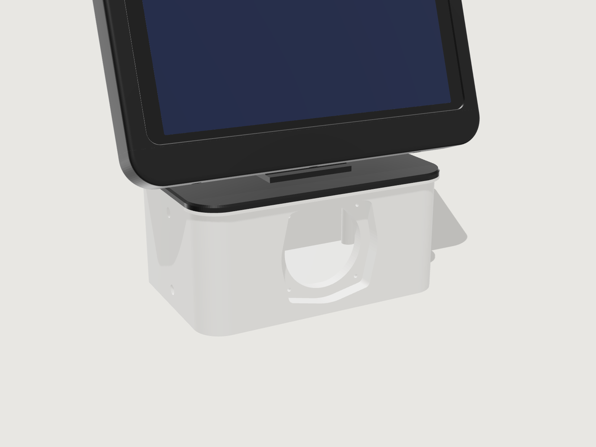
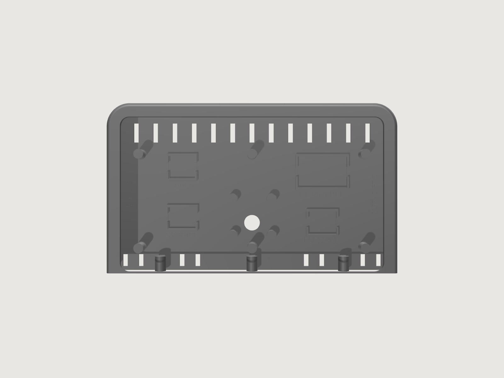

# SmartHub: Hub Mini

A small smart display to replace a Google Home or Nest Mini on a nightstand, desk or shelf. It is the
little sibling of the Counter Display on the [`main`](../../tree/main) branch and keeps the same hub
and media features. An 8.7" Samsung Galaxy Tab A9 runs the same **Counter Home** launcher: a full
screen Home Assistant dashboard with a dock of app tiles for Spotify, YouTube TV, IPTV and Assist.
A 24 GHz mmWave radar in the chin wakes the screen when someone walks up. Sound comes from one
Dayton ND65 driver in a small sealed base, run by a 2.5 W mono amp. That is plenty for a bedroom or
office, not for a party.



|  |  |
| --- | --- |
|  |  |

Overall it is 232 mm wide, 110 mm deep and 240 mm tall, with the screen tilted back 20°. Every part
fits a 256 mm print bed. The full parts list is in [BOM.md](BOM.md).

## What changed from the Counter Display

| | Counter Display (`main`) | Hub Mini (this branch) |
| --- | --- | --- |
| Tablet | Galaxy Tab A9+, 11" | Galaxy Tab A9, 8.7" |
| Audio out | USB-C to 3.5 mm adapter on a flat FPC plug | The tablet's own 3.5 mm jack |
| Amplifier | Dayton KABD-430 DSP, 20 V, Bluetooth | Adafruit PAM8302, 2.5 W mono, 5 V, no Bluetooth |
| Speakers | Two ND65s, an ND105 woofer and an ND105 passive radiator | One ND65 in a sealed 0.98 L box |
| Base finish | Linen on a grille ring, or a printed grille shell | Printed grille shell |
| Footprint | 300 x 150 mm, 324 mm tall | 232 x 110 mm, 240 mm tall |
| Print bed | 300 mm or more | 256 mm |
| Filament | About 2 kg | About 1 kg |
| Power | USB-C PD at 20 V through the same flush power plate | Same plate and trigger, a 30 W charger is enough |

The Android app, the ESPHome presence firmware and the Home Assistant automations are the same.
The ESPHome and Home Assistant files use `mini` names so a Hub Mini can run next to a Counter
Display. To run several Hub Minis, give each one its own names, as described in
[Configure Home Assistant](#5-configure-home-assistant).

## How it works

- **Display.** The tablet runs **Counter Home**, a small Kotlin launcher that replaces Fully Kiosk.
  It is the Android device owner, so it can pin itself with lock task mode, turn the panel off and
  set brightness without root. No root means YouTube TV and Spotify keep full DRM.
- **Control.** Counter Home runs a token-protected HTTP API on port 2323. Home Assistant uses it to
  wake, dim, blank and navigate the display.
- **Presence.** An ESP32-C3 SuperMini reads an HLK-LD2410C radar and reports presence to Home
  Assistant over ESPHome. Automations wake the screen, fall back to a dim clock, then turn it off.
- **Sound.** A slim 90° 3.5 mm plug in the tablet's headphone jack carries the audio. Its left and
  right channels are summed through two 1 kΩ resistors into the input of an Adafruit PAM8302 mono
  class D amp in the bezel tray. The amp drives one Dayton ND65-4 full-range driver in the base.
  With a plug in the jack, Android mutes the tablet's own speakers.
- **Power.** One USB-C charger at the wall feeds a flush port on the rear of the spine. Behind the
  port, an Adafruit HUSB238 PD trigger set to 20 V asks the charger for 20 V. That feeds a USB-C PD
  module that charges the tablet through a flat FPC 90° plug, and a 5 V buck for the amp, ESP32 and
  radar.
- **Volume cap.** In some regions Android warns before it raises wired headphone volume past a
  hearing-safety level, and that dialog would pop up on the dashboard. Counter Home holds media volume
  at or below a cap, so set the cap to 60 % and make up the loudness with the amp's gain pot.
- **Camera.** The tablet's front camera can act as a security camera for Home Assistant, exactly as
  on the Counter Display. It is off unless it is allowed on the tablet and Home Assistant turns it on.

There is no always-listening wake word, the same as on the Counter Display. Assist opens from the
dock tile, from Home Assistant, or from the tablet's assistant gesture once the Home Assistant app is
the default digital assistant.

## Repository layout

| Path | What it is |
| --- | --- |
| [`android/`](android) | Counter Home launcher: Kotlin source, Gradle build, `setup.sh` provisioning script |
| `android/CounterHome-1.0.0.apk` | Prebuilt v1.0.0. It predates the volume cap and camera, so build v1.2.0 from source |
| [`esphome/mini-presence.yaml`](esphome/mini-presence.yaml) | ESP32-C3 + LD2410C presence sensor firmware |
| [`homeassistant/packages/mini_display.yaml`](homeassistant/packages/mini_display.yaml) | REST commands, status sensors and the wake / ambient / off automations |
| [`homeassistant/auth_trusted_networks.yaml`](homeassistant/auth_trusted_networks.yaml) | Lets the dashboard load without a login screen |
| [`enclosure/enclosure.py`](enclosure/enclosure.py) | Parametric enclosure model (manifold3d). Generates every STL |
| `enclosure/stl/` | Print-ready STLs, already in print orientation |
| `enclosure/renders/` | Renders of the current STLs |
| [`BOM.md`](BOM.md) | Bill of materials |

## Build order

### 1. Print the enclosure

The STLs in `enclosure/stl/` are ready to slice. They are the `print_*.stl` outputs of the script,
already oriented for printing.

| Part | Size (mm) | Notes |
| --- | --- | --- |
| `base_tub` | 170 x 110 x 76 | Sealed speaker box for the ND65 |
| `lid_spine` | 170 x 110 x 102 | Top plate and tilted stand in one piece. Glued to the tub |
| `grille_shell` | 170 x 110 x 73 | Prints top edge down. Slides on from below, held by magnets |
| `bezel_shell` | 232 x 136 x 27 | Prints back wall down, front rim on top. Rim, tablet pocket and tray in one piece |
| `bezel_chin` | 232 x 21 x 27 | Prints back wall down. Holds the radar and closes the bottom of the shell |
| `power_plate` | 44 x 26 x 33 | Prints face down with the sled standing up. Carries the USB-C PD trigger. Same part as the Counter Display |

The bezel is the widest part at 232 mm, so a 256 mm bed works, such as a Bambu Lab A1 or P1S or a
Prusa MK4. Use PETG or ASA for the bezel shell, because it sits behind a charging tablet. Do not use
carbon-fiber or metal-filled filament for the chin: the radar looks through 1.6 mm of it.



**Measure first.** The tablet numbers come from Samsung's published size, 211.0 x 124.7 x 8.0 mm.
The corner radius, `TAB_R` = 8 mm, and the port positions are estimates. Before printing the bezel,
check three things on your tablet:

- **Corner radius.** Set `TAB_R`.
- **Port sides.** The model puts the USB-C port at the right end, seen from the front, and the
  headphone jack at the left end. Flip `USB_SIDE` if yours is the other way round, and set
  `JACK_SIDE` if both ports share one end.
- **Port heights.** If a port is not centered on its edge, set `USB_Z` or `JACK_Z` to its offset.

**Frameless bezel.** It works like the Counter Display's. The front rim and tray are one part, with
a 1.2 mm lip that overlaps the glass by 1.5 mm. The tablet slides up into the shell from below with
both plugs already in, then the chin closes the bottom with three M3 screws. The bezel bolts to the
spine from the spine's rear with four M3 bolts. The rim is 10 mm wide all round, because the 3.5 mm
plug needs 7 mm of room beside the tablet (`JACK_CLEAR`). The USB-C side needs 4 mm (`USB_CLEAR`).
The tray is 17 mm deep, set by `PARTS_H`, the tallest board on its back wall. Each board has a
cradle with a raised label. Change the cradle sizes in `CRADLES` to the boards you buy.

**Base.** The ND65 sits in a recess shaped to its frame, 4 mm behind the inner face of the grille
shell, with blind pilot holes on its 66 mm bolt circle and a notch on top for its solder tabs. The
whole tub is one sealed chamber of 0.98 L, before subtracting the driver. The grille shell is a
2.85 mm printed skin with a honeycomb of 2.6 mm hexagonal holes over the front. Its eight magnets
sit on the rear and sides, so the honeycomb can run the full height of the driver. Set
`SHELL_SIDES = True` to perforate the sides too.

To change dimensions, edit the `PARAMETERS` block in `enclosure.py` and regenerate:

```
pip install -r enclosure/requirements.txt
python enclosure/enclosure.py enclosure/out
```

The script prints part sizes, the chamber volume, and how much spine material each bezel bolt passes
through. Copy the `print_*.stl` files over the ones in `enclosure/stl/`, dropping the `print_` prefix.

### 2. Assemble

1. Press the M3 heat-set inserts into the bezel shell: three from below into the chin bosses, and
   four from the back into the spine-bolt bosses. Press two more into the power plate pocket on
   the spine's rear face.
2. Glue a 6 x 2 mm magnet into each of the 8 tub pockets and a 6 x 1 mm magnet into each grille
   shell pocket. Check polarity before the glue sets. The tub magnets sit 0.2 mm below the surface
   and the shell magnets sit flush.
3. Solder the speaker pair to the ND65, mount it from the outside on 1 mm gasket tape with M3 x 6
   screws in the pilot holes, solder tabs up into the notch. Add a loose handful of polyfill.
4. Feed the speaker pair up through the 6 mm hole in the lid, then glue the lid to the tub using the
   four dowels for alignment. Seal the hole around the wire with hot glue. The box must be airtight.
5. Slide the grille shell onto the tub from below.
6. Set the PD trigger's DIP switch to 20 V, with only the 20 V switch on. Screw the board to the power
   plate's sled with four M2.5 x 6 thread-forming screws, USB-C socket toward the opening. Put 18 AWG
   leads in its screw terminal, feed them through the cavity and up the cable channel into the tray,
   then screw the plate flush with two M3 x 8 countersunk screws. Before connecting anything else,
   plug in the charger and check for 20 V at the leads.
7. Set the MP1584 buck to 5.0 V before connecting it. These modules ship at a random output voltage.
8. With the bezel shell face down, stick the PD module, buck, amp and ESP32-C3 into their cradles
   with VHB tape. Wire 20 V to the PD module and the buck, and 5 V from the buck to the amp's VIN,
   the ESP32-C3's 5V pin and the radar.
9. Wire the audio. Cut the 3.5 mm cable about 25 cm from the slim 90° plug. Solder tip and ring
   each through a 1 kΩ resistor to the amp's A+ input, and the sleeve to A−. Leave SD unconnected.
   Solder the speaker pair to the amp's output terminals. The PAM8302 is a bridge-tied output, so
   never connect either speaker wire to ground.
10. Plug the flat FPC 90° adapter into the tablet's USB-C port and connect it to the PD module.
    Plug the 3.5 mm plug into the jack. Use a 3-pole TRS plug: a 4-pole headset plug can switch the
    tablet to a headset microphone that isn't there, and Assist would stop hearing you.
11. Put 0.5 mm felt pads on the six back-stop posts. Slide the tablet up into the shell from the
    bottom, glass toward the lip, with each plug riding in its channel.
12. Fit the radar into the chin, run its wires up to the ESP32-C3, and screw the chin on from below
    with three M3 x 12 screws.
13. Thread the speaker pair and power leads down the spine's cable channel, then bolt the bezel to
    the spine from the spine's rear with four M3 x 16 bolts. The lower pair sits in deep
    counterbores, so use a long 2.5 mm hex key.

Hum or charging noise is less likely than on the Counter Display, because the sleeve goes to the
amp's negative input, not to its ground. If you still hear it, put a 3.5 mm ground loop isolator
between the tablet's plug and the cut cable.

### 3. Flash the presence sensor

```
cd esphome
esphome run mini-presence.yaml
```

The first flash needs USB; after that updates go over the air. Wiring is at the top of the YAML.
It needs `mini_presence_api_key`, `ota_password`, `wifi_ssid` and `wifi_password` in your
ESPHome `secrets.yaml`. Suggested radar tuning is in the YAML comments. For more than one Hub Mini,
change `name` in the YAML for each one, for example `bedroom-presence`.

### 4. Provision the tablet

1. Build Counter Home v1.2.0, as described in [Building the app](#building-the-app). The Hub Mini
   needs the volume cap, which the prebuilt v1.0.0 doesn't have.
2. Factory reset the tablet. Connect Wi-Fi, skip every Google and Samsung sign-in, and turn on USB debugging.
   Device owner can only be set while the tablet has no accounts.
3. On your computer, with Android platform-tools installed:

   ```
   cd android
   ./setup.sh http://<HA_IP>:8123/dashboard-mini/0?kiosk
   ```

   It installs the APK, makes Counter Home the device owner, removes Samsung extras, and prints the
   tablet IP, the API token and the Home Assistant secrets. Reserve that IP on your router. The
   secrets are named `mini_display_*`. For a second Hub Mini, set `NAME`, for example
   `NAME=bedroom_display ./setup.sh ...`.
4. On the tablet, hold the dock clock for 3 seconds and enter PIN `2580`. Choose
   "Pause kiosk lock and open Android settings". Sign in to Google, install Spotify, YouTube TV,
   IPTV Smarters and the Home Assistant app, turn on battery protection, and make Home Assistant
   the default digital assistant. Then tap "Resume kiosk lock".
5. Change the settings PIN. The default PIN is public in this repository.
6. Set "Max media volume" to 60 % in the settings screen. Play music at that volume and turn the
   amp's gain pot up until it is as loud as you want.
7. To use the camera, tick "Allow the camera" in the settings screen. It stays off until Home
   Assistant turns it on. Also check that Android's camera access toggle is on: Settings > Security
   and privacy > More privacy settings > Camera access. When it's off, every frame comes out black.

Do the YouTube TV and Spotify sign-ins while the kiosk lock is paused. Google's login screens
belong to other packages, and lock task mode blocks them.

### 5. Configure Home Assistant

1. Copy `homeassistant/packages/mini_display.yaml` into `config/packages/` and enable packages in
   `configuration.yaml`. It uses its own entity names, so it works next to `counter_display.yaml`.
2. Add the three secrets `setup.sh` printed to `secrets.yaml`:
   `mini_display_token`, `mini_display_api` and `mini_display_status`.
3. Merge `homeassistant/auth_trusted_networks.yaml` into the `homeassistant:` block. Create a non-admin
   user for the tablets and put its user ID and each tablet's IP in the snippet.
4. Make a dashboard for the Hub Mini at `dashboard-mini`. The 8.7" screen is 1340 x 800, so fewer,
   larger cards work better than a copy of the counter dashboard.
5. Install the HACS "kiosk-mode" plugin so `?kiosk` hides the header and sidebar, then restart Home Assistant.

The automations expect the presence entity `binary_sensor.mini_presence_presence`, which the
ESPHome config creates.

**More than one Hub Mini.** Copy the package once per unit. In each copy, replace every
`mini_display` and `mini_presence` with that unit's names, such as `bedroom_display` and
`bedroom_presence`. Match the ESPHome `name` (`bedroom-presence`) and the `NAME` you gave `setup.sh`.

| Time with nobody present | What happens |
| --- | --- |
| Someone arrives | Screen on. Brightness 25 from 22:00 to 06:00, auto otherwise |
| 2 minutes | Dim clock overlay, if the dashboard is in front |
| 10 minutes | Panel off, if the dashboard is in front |
| 30 minutes | Back to the dashboard and panel off, if another app was open |

A notification fires if the tablet battery stays above 42 °C for 5 minutes.

### 6. Camera in Home Assistant (optional)

1. Tick "Allow the camera" in Counter Home settings on the tablet.
2. In Home Assistant, go to Settings > Devices & services > Add integration > MJPEG IP Camera, name it
   `Mini display` and use:

   ```
   MJPEG URL:        http://<tablet_ip>:2323/camera.mjpeg?token=<token>
   Still image URL:  http://<tablet_ip>:2323/camera.jpg?token=<token>
   ```

   That creates `camera.mini_display`.
3. The package's camera automations turn the camera on five minutes after everyone has left, turn it
   off as soon as someone is home, and snapshot anyone the radar sees while nobody is home. They use
   `zone.home`, so they need person entities with device trackers. Uncomment the
   `notify.mobile_app_...` lines for a phone push.

A Hub Mini often lives in a bedroom. Think about where the camera points before you allow it, and
leave it off where it doesn't belong. Never forward port 2323 to the internet. The camera behaves as
described for the Counter Display: a red `● CAM` in the dock while it runs, no night vision, one app
at a time, and some extra heat while streaming.

## Counter Home API

Every call needs `Authorization: Bearer <token>` or `?token=<token>`. Port 2323.

| Call | Does |
| --- | --- |
| `GET /status` | JSON: screenOn, ambient, launcherInFront, deviceOwner, kioskPaused, battery, charging, batteryTempC, volume, maxVolume, cameraAllowed, camera, ip |
| `POST /screen/on`, `/screen/off`, `/screen/toggle` | Panel power |
| `POST /ambient/on`, `/ambient/off` | Dim clock overlay, tap to dismiss |
| `POST /home` | Back to the dashboard from any app |
| `POST /launch?app=Music` | Tile label or package name |
| `POST /assist` | Opens the default assistant (HA Assist) |
| `POST /navigate?url=...` | Load any URL in the dashboard view, such as a camera page when the doorbell rings |
| `POST /brightness?value=0-255` or `?value=auto` | Backlight |
| `POST /reload` | Reload the dashboard |
| `POST /camera/on?minutes=N` | Camera on. With `minutes`, it turns itself off after that long. Needs "Allow the camera" |
| `POST /camera/off` | Camera off |
| `GET /camera.jpg` | Latest frame as JPEG. 503 while the camera is off |
| `GET /camera.mjpeg` | MJPEG stream, up to 3 at once. It ends when the camera turns off |
| `GET /config`, `POST /config` | Read or change settings as JSON: haUrl, tiles, dockSide, kioskLock, maxVolume, cameraFacing, cameraWidth, cameraFps, cameraQuality, cameraRotation, pin, port |

`volume` and `maxVolume` are percentages of the tablet's media volume range.

`camera` in `/status` reports `running`, `facing`, `width`, `height`, `frameAgeMs`, `offInSeconds`
and the last `error`. Camera defaults: front camera, up to 1280 px wide, 5 frames per second, JPEG
quality 70. `cameraRotation` -1 follows the screen orientation; 0, 90, 180 or 270 force it.

Quick test from any machine on the LAN:

```
curl -H "Authorization: Bearer <token>" http://<tablet_ip>:2323/status
```

Example tiles JSON, for the settings screen or `POST /config`:

```json
{"tiles": [
  {"label": "Music",   "package": "com.spotify.music", "color": "#1F8F4E"},
  {"label": "Live TV", "package": "com.google.android.apps.youtube.unplugged", "color": "#C43B33"},
  {"label": "IPTV",    "package": "com.nst.iptvsmarterstvbox", "color": "#3A62B8"},
  {"label": "Assist",  "action": "assist", "color": "#16A3C9"}
]}
```

Tile actions are `assist`, `reload` and `home`. The dock can sit on the right, left or bottom.

## Building the app

You need JDK 17+ and the Android SDK with platform 34. Point `android/local.properties` at the SDK
with `sdk.dir=/path/to/Android/sdk`, then:

```
cd android
./gradlew assembleRelease
adb install -r app/build/outputs/apk/release/app-release.apk
```

The app has no dependencies beyond the Android framework and the Kotlin stdlib.

**The signing keystore is not in this repository.** The repository is public, and anyone holding the
key could sign an update that replaces the device-owner app. Copy your `counterhome.jks` into
`android/keystore/` before building; that folder is git-ignored. Without the keystore the release
APK builds unsigned. Updates must be signed with the same key, or Android refuses to install them
over the device-owner app, and replacing a device owner takes a factory reset. Back the keystore up.

Store and key passwords default to the values the keystore was created with. Override them with the
Gradle properties `counterhome.storePassword`, `counterhome.keyAlias` and `counterhome.keyPassword`,
for example in `~/.gradle/gradle.properties`.

## Undo

Open the settings screen and choose "Release device owner". The tablet goes back to being a normal
Android tablet. A factory reset also clears it.

## Not yet verified

Nothing on this branch has been printed or assembled yet. Check these before a full print:

- **Tablet fit.** `TAB_R`, the port sides and the port heights are estimates. Print the bezel chin
  and the bottom 30 mm of the shell first to test the fit.
- **Plug sizes.** The 3.5 mm plug must stick out no more than 7 mm past the tablet's edge, and the
  USB-C FPC plug no more than 4 mm.
- **Board sizes.** The PD module, buck and amp cradles are set to typical board sizes. Measure yours
  and update `CRADLES`. The tallest board must stay under 13 mm, or raise `PARTS_H`.
- **Volume warning.** The 60 % cap is a starting point. If the hearing-safety dialog still appears,
  lower the cap one step and raise the amp gain.
- **Microphones.** The four slots in the top rim follow the Counter Display. Check where the Tab A9's
  microphones are and move `MIC_SLOTS_X` if Assist hears you poorly.
